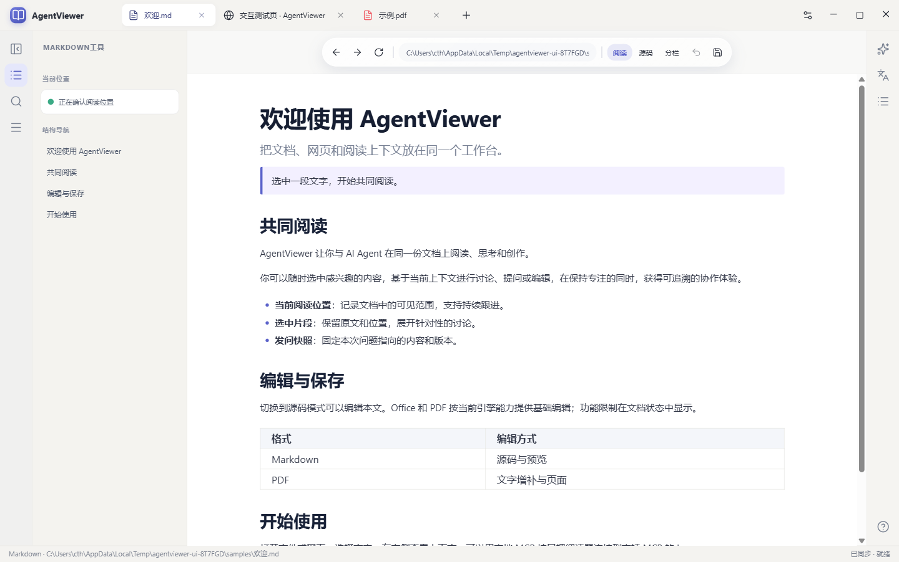

# AgentViewer


面向人类与 agent 共同使用的桌面文档工作台。文件和网页使用统一标签；阅读位置、选中片段、未保存内容、修改版本和保存回执通过同一套接口向 harness 提供。

当前为 **0.1.0 持续实现版本**：包含 Electron 桌面应用、格式编辑器、原生网页输入、HTTP/CLI/MCP 与 Codex 插件开发目录。2026-10-10 加入独立设置窗口、文档独立译文和网页原地翻译；2026-10-14 完成 Windows 原生 Office 阅读区、应用内常用属性工具及安装版三格式编辑/撤销/保存重开验收。完整交付仍按[功能需求基线](docs/AgentViewer-功能需求与项目结构设计.md)验收；[实施状态与升级路线](docs/实施状态与升级路线.md)区分已验证能力与尚需引擎的项目。



## 启动

需要 Node.js 24 及 npm：

```powershell
npm.cmd install
npm.cmd run dev
```

使用构建产物：

```powershell
npm.cmd run build
npm.cmd start
```

`dev` 同时启动 Vite 和 Electron；`start` 使用构建后的桌面应用。`dev:web` 是界面开发预览，原生网页输入和多窗口需要桌面模式。首次启动会生成五种格式的示例文件和一个本地交互测试网页。Windows x64 可执行 `npm.cmd run package:portable` 得到包含离线引擎的 `release/win-unpacked` 目录包；随后运行 `npm.cmd run install:local`，复制到 `%LOCALAPPDATA%\Programs\AgentViewer` 并建立开始菜单的 **AgentViewer** 快捷方式。更新已安装版本前需关闭应用；用户数据保存在独立目录。

Windows 源码构建还需要 Visual Studio Build Tools 的 MSVC x64 C++ 工具链，用于编译内嵌 Office 光栅适配器；构建脚本通过 `vswhere` 发现工具链并校验缓存。发布包包含编译好的适配器，运行应用不需要安装编译工具。

Windows 打包会通过 `engines:bootstrap` 生成并内置经过校验的 Office 初始化缓存；也可在引擎准备后单独运行该命令。普通前端构建和阅读非 Office 文件不会预启动内核。缓存仅包含尚未加载文档时生成的内置扩展注册数据与安装完成标记，每个工作进程仍使用独立配置目录。

数据默认位于 `%APPDATA%\AgentViewer`，HTTP 仅监听 `127.0.0.1:3210`。新文件须选定保存位置；源文件被其他程序修改时会拒绝覆盖。复杂 Office 文件建议另存副本。

## 阅读界面、设置与翻译

新标签页中央提供液态玻璃搜索栏，输入网址或本地文件路径按 Enter 打开，输入文件名即时搜索文档库、示例和生成译文。使用 ↑／↓ 选择结果、Esc 收起、Ctrl+L 聚焦；已有文件复用编辑会话，打开内容直接替换发起请求的新标签页。每个新标签页保留自己的查询；慢速打开期间仍可切换标签，完成结果不会抢走当前阅读目标。搜索栏采用 [kube.io Searchbox](https://kube.io/blog/liquid-glass-css-svg/#searchbox) 的聚焦舒展、按压和材质弹簧，完整折射保持 0px Gaussian 模糊。

网页地址栏接受 `example.com`、`www.example.com/path` 等省略协议的网址，公网域名默认 HTTPS，localhost、完整 IPv4／IPv6 默认 HTTP；显式协议保留。地址栏导航始终使用当前网页标签，与主页和 SDK 共用规范化逻辑，文档文件名仍作为文件检索。导航胶囊末尾的“×”可主动关闭；关闭后向上滚动、回到文档顶部、普通悬停或切换标签都不会重新展开，仅进入阅读区域顶边 6px 范围或网页中使用 `Ctrl+L` 时恢复。收起采用上滑、轻微缩小与淡出，展开柔和回弹；网页浮层重新挂载时也保留入场过渡，`Ctrl+L` 直接聚焦输入，不等待动画。

左上角只保留静态标识；加号打开主页样式的新标签页，打开文件时直接使用该标签。最近文档、示例和生成的译文集中在主页文档库。阅读页两侧是悬浮圆角工具面板：左侧根据格式显示大纲、查找及可用工具，重复点击当前图标可收起面板；网页不显示左侧工具。右侧 AI 工具栏按需展开。文档顶部只有不占整行的玻璃胶囊，默认不自动隐藏；可在设置开启滚动收起，仍可使用“×”主动关闭。本地文档仅显示文件名，网页显示地址。各格式提供单行图标选区胶囊，PDF 高亮、下划线和批注可直接从选区操作；旋转、增页和 OCR 留在左侧格式工具。设置中的“文档阅读背景”提供暖纸、晨雾、极光、暮光和纯色，不写入文档。`Ctrl+,` 打开独立、非模态的设置窗口；尚未接入的偏好会显示依赖原因并禁用控件。

文档选中文字后，可在右侧浮窗或抽屉查看译文、复制和固定卡片；这一过程不修改原文文件或撤销栈。全文翻译会冻结发起时的字节并在后台生成新的同格式文件，支持取消后从已完成片段继续。Markdown、HTML、DOCX、PPTX、XLSX 的基础结构译文已接入；Office 复杂样式、PPT 溢出及 Excel 扩展需要人工验收。PDF 全文翻译使用内置 [BabelDOC](https://github.com/funstory-ai/BabelDOC) 0.6.4 适配器与离线版面资源，已通过一页 PDF 的模型桥往返；复杂样本尚未验收。BabelDOC 采用 AGPL-3.0 许可证。

网页翻译只替换当前页面的文字节点，不提交或保存到站点。可显示原文，页面自身改动过的节点不会被旧恢复操作覆盖；动态新增文字可按设置继续翻译。翻译改变布局后，MCP 坐标输入必须携带新的 `layoutRevision`。

设置中的模型连接支持 OpenAI Responses、Chat Completions 兼容服务和 Anthropic Messages；可以给选区、全文、网页和问答分别指定连接，也可以选择本机 Codex Harness。密钥由 Electron `safeStorage` 加密写入本地配置，设置导出和读取接口不返回密钥。PDF 适配器通过短时本地桥接令牌调用模型，避免把实际服务密钥放入 BabelDOC 进程参数。

## 当前编辑范围

| 格式 | 已实现 | 限制 |
| --- | --- | --- |
| Markdown | CodeMirror 源码、GFM 预览、源码/预览分栏、范围修改与保存 | 数学/图示插件和稳定的源码/渲染映射待补 |
| DOCX | 阅读区中的真实 Writer 编辑；应用内文字/段落属性、样式、图文、字段、表格、页面、引用和审阅分类；真实 DOCX 保存与重开 | Windows 原生引擎；复杂功能可使用原生对话框或属性面板，不宣称所有命令都已验收 |
| PPTX | 真实 Impress 画布；左侧实际缩略图、对象、设计、排列、切换、动画、放映和备注；应用内对象属性与真实撤销 | 复杂母版/动画仍由内置引擎执行；对象查询使用真实名字与明确单位 |
| XLSX | 真实 Calc 编辑与计算；紧凑公式栏、单元格属性、函数、数据、工作表、冻结和打印分类；真实 XLSX 保存与重开 | 原生范围查询不受旧界面镜像的 1000 行/50 列限制；结构镜像用于辅助读取，不能覆盖活跃原生模型 |
| PDF | 真实画布与文字层、中文文字增补、覆盖式高亮、页面旋转/新增、保存 | 高亮是写入页面的矩形；原生批注、表单、删除/重排未实现。增补坐标限未旋转、CropBox 原点为零的页面 |
| 网页 | Chromium 浏览、导航、多视图、截图、鼠标/键盘、顶层可见文字与选区 | DOM 元素引用、跨 frame 语义读取、下载管理和多 profile 设置待补 |
| HTML/网页副本 | 源码、净化预览、位置/选择、保存 HTML；可从真实网页建立副本 | 资源仍使用原链接；无完整离线资产包和结构富文本编辑器 |

`.doc/.ppt/.xls` 使用内置 LibreOffice 26.8.1 转换器：保留原件，转换后编辑并另存现代格式。DOCX/XLSX/PPTX 在 Windows 阅读区内使用同一份真实 LibreOffice 模型。桌面主线直接加载核心 DLL，由 AgentViewer 绘制真实图块、承接键鼠与中文组合输入，不为每份文档启动一个 Office 编辑窗口。主工具默认在左栏；引擎命令按需展开，常用属性用应用自己的控件和类型化 MCP 事务。Office 运行时按需启动，主题、外围画布与纸面颜色独立设置，不回写文档页面样式。具体能力与验收边界见[内嵌 Office 核心](docs/design/EMBEDDED_OFFICE_CORE_2026-10-14.md)。PDF OCR 使用内置 Tesseract.js 与中英文字库；EPUB 为后续适配器。

## 原生网页输入

网页由独立 `WebContentsView` 承载；`click/move/drag/scroll/press/type` 发送给实际 Chromium 页面，中文输入使用原生文本插入。

MCP 顺序：`workspace_list` 确认目标 → `reader_get_context` / `browser_capture` 读取视口 → `browser_input` → 核对回执。坐标为网页视口内的 **CSS 像素**；截图另有位图尺寸和 CSS 视口，不能直接使用位图像素作为输入坐标。

```json
{
  "viewId": "从 workspace_list 取得",
  "expectedNavigationId": "从 context.viewport.navigationId 取得",
  "expectedLayoutRevision": 0,
  "expectedViewport": { "width": 900, "height": 700, "scrollX": 0, "scrollY": 0 },
  "action": { "kind": "click", "x": 120, "y": 160, "button": "left" },
  "idempotencyKey": "每个新操作使用独立的唯一键"
}
```

`expectedViewport` 可选，基于截图操作时应提供。网页翻译后 `expectedLayoutRevision` 必填且应取最新值。导航、布局、尺寸或滚动变化会拒绝旧请求；同键同请求返回原回执。实时网页提交影响该站点；持久文档编辑使用“编辑副本”。Agent 鼠标会通过穿透输入的独立透明窗口显示轨迹与点击反馈。

## Harness、MCP 与插件

应用运行后，执行 `npm.cmd run mcp` 启动 stdio MCP，或让 MCP 客户端连接构建产物：

```json
{
  "mcpServers": {
    "agent_viewer": {
      "command": "node",
      "args": ["D:/CodexProj/AgentViewer/dist/mcp/index.mjs"]
    }
  }
}
```

插件开发包位于 [`plugins/agent-viewer`](plugins/agent-viewer)，包含 manifest、MCP 发现启动器及 reading/editing 两个 Skill。启动器根据本地运行发现信息查找产物；本轮未修改用户 Codex 插件配置，也未发布到插件市场。

MCP 支持枚举、打开、位置/选择、快照、正文/大纲/搜索、能力、准备/应用修改、保存/撤销、视图和网页操作。`reader_selection_tools` 与 `reader_selection_action` 开放与选区胶囊相同的工具；`document_annotations` 与 `document_remove_annotation` 管理独立批注。HTTP、MCP、CLI 共用 `dispatch` 与 `ViewerCore`，访问同一份打开的内容。

```powershell
npm.cmd run cli -- state
npm.cmd run cli -- context
```

右侧还有 Codex CLI 驱动入口：在连接设置启用后发送问题，使用 `codex app-server`、固定快照、流式结果和取消，复用已有登录配置。驱动创建独立线程，当前不能附着本条 Codex 桌面会话。实际模型回合和交互授权尚未验收；独立 MCP 连接不依赖此驱动。

## 配置与验证

| 环境变量 | 用途 |
| --- | --- |
| `AGENTVIEWER_DATA_DIR` | 数据目录，测试使用独立临时目录 |
| `AGENTVIEWER_PORT` | HTTP 端口，默认 3210 |
| `AGENTVIEWER_CONNECTION_FILE` | SDK/MCP 指定运行发现文件 |
| `AGENTVIEWER_CODEX` | Codex 原生可执行文件 |
| `AGENTVIEWER_LIBREOFFICE` | 可选：覆盖内置 LibreOffice `soffice` 路径 |
| `AGENTVIEWER_PDF_FONT` | 可嵌入字体；Windows 默认尝试黑体 |
| `AGENTVIEWER_BABELDOC` | 可选：覆盖内置 BabelDOC CLI 路径 |

运行发现文件包含本地凭据，不应复制到报告或提交仓库。外部网页禁止访问工作台 API；bearer 接口不能伪造人类上下文或窗口布局。细分文档授权和凭据撤销仍需后续实现。

```powershell
npm.cmd run build
npm.cmd test
npm.cmd run test:home-search
npm.cmd run test:desktop
npm.cmd run test:ui
npm.cmd run engines:verify
npm.cmd run test:engines
```

桌面测试启动独立 Electron 实例，在临时样本上操作并生成截图，结果目录由测试输出提供。使用动态端口的专项测试无需关闭安装版；固定 3210 的旧测试需避免端口冲突。依赖版本由 `package-lock.json` 固定。`native-frame-subscription-probe.e2e.ts` 是底层 API 诊断实验，150% 的未对齐奇数区域故意保留严格失败用于揭示半像素重采样，不是通过型 CI 回归；生产采样的验收使用 `native-frame-sampling.e2e.ts`。

- [接口与扩展](docs/接口与扩展.md)：格式、浏览器、存储和 harness 升级接口。
- [扩展架构 ADR](docs/adr/0001-扩展架构与首轮引擎.md)：首轮引擎与持久化决策。
- [实施状态与升级路线](docs/实施状态与升级路线.md)：功能范围、验收证据和下一轮计划。
- [全面编辑能力规划](docs/design/EDITING_CAPABILITIES_PLAN_2026-10-12.md)：Markdown 对标 Typora、Office 对标 LibreOffice、PDF 完整编辑的功能矩阵、内置引擎、harness 命令与实施门槛。
- [按格式重构左侧工具箱](docs/design/LEFT_TOOLBOX_REQUIREMENTS_2026-10-12.md)：从编辑任务重新设计 Markdown、Word、PPT、Excel、PDF 与 HTML 的分组、对象属性、真实缩略图、统一命令、MCP 契约和验收；这是需求设计，尚未实施新左栏。
- [统一导航实现](docs/design/NAVIGATION_SHARED_2026-10-12.md)：共享模块、滚动阈值与无常驻底栏布局；光学参数以之后的 kube.io 研究和最新材质范围为准。
- [Liquid Glass 光学研究](docs/design/LIQUID_GLASS_OPTICS_RESEARCH_2026-10-12.md)：官方与开源实现比较、凸面折射模型、真实正文采样与动态验证。
- [Liquid Glass 组件与弹性](docs/design/LIQUID_GLASS_COMPONENTS_2026-10-12.md)：作者示例映射、spring 参数及设置拖动 undo；普通组件采用轻量磨砂，导航、Agent 胶囊和 AI 结果／译文小浮窗使用完整折射。
- [工具与交互更新](docs/design/UI_POLISH_2026-10-12.md)：Office 默认左侧编辑、11 项 AI 阅读工具、优雅动效、真实界面和安装同步验收。
- [独立设置窗口改造](docs/design/SETTINGS_REDESIGN_2026-10-12.md)：分组布局、拖动开关/枚举、即时保存与全局撤销、按需材质预览及接口边界。
- [阅读器渲染性能修复](docs/design/RENDERING_PERFORMANCE_2026-10-12.md)：原生 PNG/图片复用、双预算 LRU、全字段 sharing、Office memo 和真实计数验收。
- [架构调研与 MCP 设计](docs/AgentViewer-架构调研与MCP设计.md)：选型依据。

- [原生 Office 集成](docs/design/NATIVE_OFFICE_INTEGRATION_2026-10-13.md)：真实编辑源、格式工具、MCP、版本、撤销、可见表面与保存边界。
- [REA 分析与工具内化](docs/design/REA_OFFICE_INTERNALIZATION_2026-10-13.md)：已安装工具、实际二进制证据、常用属性、性能改动及未完成范围。
- [本轮验收](docs/validation/NATIVE_OFFICE_2026-10-13.md)：真实 Electron/MCP、保存重开、界面操作、启动恢复与安装同步。
