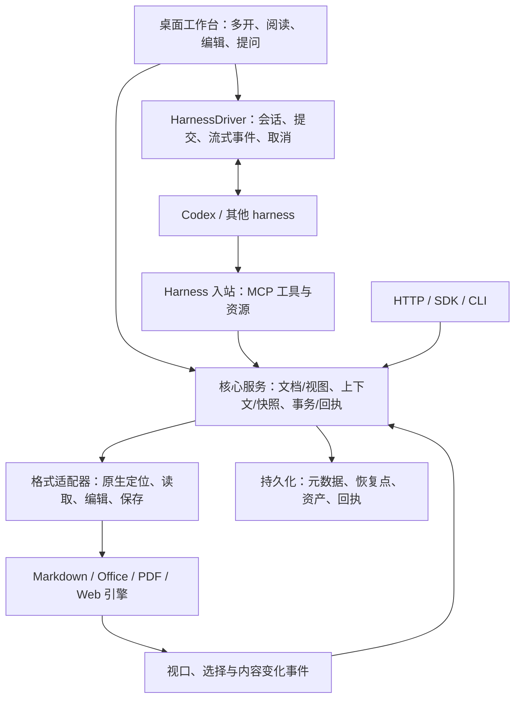

**AgentViewer 功能需求与项目结构设计**

版本：0.2　｜　日期：2026-10-09　｜　状态：功能需求基线，已开始首轮实现

本文用于实现、开源组件接入和完整交付验收。项目已开始首轮基础实现；文中的模块、接口和能力仍是设计要求，不能全部视为已完成。实际范围与验证证据见[实施状态与升级路线](./实施状态与升级路线.md)。目标为 Windows 桌面横版应用，先按 1440×900 至 1920×1080 的工作区设计，移动端不在范围内。

本文承接《AgentViewer：综合阅读器、统一阅读状态与 Codex 插件设计调研》。实现与验收以本文的格式覆盖和编辑要求为准：Markdown、Office 文档/演示/表格、PDF、网页均须提供可持久化的编辑能力，能力受文件格式、文档保护与引擎支持限制。早期调研中先阅读后编辑的阶段安排不作为本需求的交付边界。

01. **产品目标、交付范围和优先级**

AgentViewer 是面向人类与 agent 共同使用的文档阅读编辑工作台。用户可像使用浏览器一样同时打开文件和网页，阅读、选择、修改并保存；外部 harness 能获取用户指向的具体内容，读取同一份打开的文档，执行有定位、有版本约束、可核验的修改。

核心闭环为：打开文档 → 阅读与选择 → 固定问题所指的上下文 → harness 读取或操作 → 用户看到结果 → 保存与撤销。阅读工作台可以独立使用，接入 harness 后增加共同操作能力。

优先级：

- P0：首个完整版本的必需能力，缺少任一强制格式的基线编辑、保存、位置或选区支持，不能称为完整版本。
- P1：增强编辑、复杂文件兼容和更多 harness 驱动；逐项按能力声明启用。
- P2：跨设备同步、多人协作及高级扩展，可独立演进。

| 文件类别 | P0 强制覆盖 | P0 编辑与持久化要求 | 格式边界 |
| --- | --- | --- | --- |
| Markdown | .md、.markdown；UTF-8 与常见换行 | 源文编辑、局部结构修改、保存原文件或副本 | 特殊语法保留原文；不认识的语法不能静默删除 |
| Office 文档 | .docx；.doc 导入后转换编辑 | 正文、基本格式、表格、图片、批注；保存 .docx，导出 PDF | .doc 保留原始文件，编辑结果默认另存 .docx；回写旧格式须有经过验证的转换链路 |
| Office 演示 | .pptx；.ppt 导入后转换编辑 | 幻灯片、文本、基本形状/图片、备注；保存 .pptx，导出 PDF | .ppt 默认另存 .pptx；复杂动画、SmartArt、嵌入对象需给出保真范围 |
| Office 表格 | .xlsx；.xls 导入后转换编辑 | 单元格、公式、基本格式、工作表和范围操作；保存 .xlsx，导出 CSV/PDF | .xls 默认另存 .xlsx；公式、宏和外部链接分别声明支持范围 |
| PDF | 含文字、扫描页及混合页面的常见 PDF | 批注、高亮、文字/图片增补、表单填写、页面增删/重排/旋转，保存 PDF | 原有正文重写、真正脱敏及签名维护为独立能力，不将视觉覆盖当作原文删除 |
| 网页/HTML | HTTP(S) 网页、本地 .html/.htm、可编辑阅读副本 | 本地 HTML 源码/内容编辑；网页快照的正文、批注、排版编辑；保存本地副本 | 远程网页的副本编辑和原站数据提交分别处理；DOM 临时变化不算持久化保存 |
| 扩展格式 | P1：EPUB、ODT/ODS/ODP、CSV、带宏 Office 等 | 复用同一会话与操作协议，按适配器增加编辑 | 不计入首版强制格式，但保留明确的扩展入口 |

受保护、加密、损坏或引擎不支持的具体文件，可以以受限能力打开，并给出可执行的处理方案；正常验收样本必须具备该格式的 P0 编辑能力。此规则不能用于将整个格式模块降为只读。

EPUB 扩展的目标为目录/重排阅读、跨字号和窗口尺寸的稳定位置、章节 XHTML/CSS 编辑、批注及重新打包保存；优先复用 foliate-js 和 Readium 定位思路。CFI/章节引用需要版本映射，不能只记录滚动百分比；DRM 文件不纳入无条件编辑。该适配器在 P1 单独建立需求与往返保存验收。

02. **主选开源项目与集成职责**

以下是工程主选与备选，主选不代表已安装或已完成兼容验证。实现时应固定版本与来源，记录许可证、引擎接口、增补代码和测试样本；基础功能不依赖商业扩展。

| 项目 | 集成定位 | 决策 | AgentViewer 自建部分 |
| --- | --- | --- | --- |
| [Electron](https://www.electronjs.org/docs/latest/api/web-contents-view) | 桌面窗口、多进程、WebContentsView 网页容器、本地 IPC | 主选；React + TypeScript 构建工作台 | 标签/窗口管理、浏览器操作、内容隔离、上下文桥接 |
| [CodeMirror 6](https://code.haverbeke.berlin/codemirror/view) | Markdown、HTML 源码编辑 | 主选；GitHub 仓库已指向当前上游 | 编辑事务、源码定位、预览映射、选区采集 |
| [remark / unified](https://github.com/remarkjs/remark) | Markdown AST 与渲染管线 | 主选；结合 GFM、数学和图示插件 | 保留未知语法、稳定块映射、内容结构读取 |
| [ONLYOFFICE Docs](https://github.com/ONLYOFFICE/DocumentServer) | 内嵌 DOCX/XLSX/PPTX 编辑器与格式转换服务 | Office 主选开源编辑引擎；独立服务模块 | 文档网关、保存回调、同文档会话协调、office-state-bridge、harness 语义操作 |
| [LibreOffice](https://www.libreoffice.org/) | 旧版 Office/ODF 转换、导出及兼容处理 | 本地转换器主选；必要时原生会话扩展 | 临时工作区、转换任务、损失报告、转换前后身份映射 |
| [PDF.js](https://github.com/mozilla/pdf.js) | PDF 渲染、文字层、选区与注释编辑基础 | PDF 阅读与注释主选 | 真实可见区域、页面坐标、命令记录、批注侧边栏、保存协调 |
| [pdf-lib](https://github.com/Hopding/pdf-lib) | PDF 文字/图片增补、表单与页面操作 | PDF 持久化操作的补充组件 | 与 PDF.js 注释合并的导出流水线、字体、页面身份与锚点映射 |
| [Tiptap / ProseMirror](https://tiptap.dev/docs/editor/getting-started/overview) | 网页阅读副本和本地 HTML 的结构编辑 | 主选开源核心；商业批注/历史扩展不计入基线 | 受支持 HTML schema、资产管理、批注、版本历史 |
| [DOMPurify](https://github.com/cure53/DOMPurify) | 阅读副本中的 HTML 清理 | 主选 | 资源策略、允许的节点和属性、保留与丢弃报告 |
| [Tesseract.js](https://github.com/naptha/tesseract.js) | 扫描页与图像 OCR | P1 增强；扫描 PDF 的区域图像读取为 P0 | PDF.js 栅格化、任务调度、语言包、文字位置与置信信息 |
| [SQLite / FTS5](https://www.sqlite.org/fts5.html) | 工作区、恢复点、批注、搜索索引与操作记录 | 主选本地持久化 | 版本化数据模型、文档权限过滤、缓存淘汰与迁移 |
| [MCP TypeScript SDK](https://ts.sdk.modelcontextprotocol.io/server) | harness 入站工具、资源与协议兼容 | 主选；适配实际客户端支持的协议版本 | 工具 schema、认证、作用域、能力协商、stdio 桥接 |

PDF.js 源码已有 FreeText、Highlight、Ink、Stamp 等注释编辑类型；实际接入以固定版本的可用 API 与保存测试为准。[注释编辑类型源码](https://github.com/mozilla/pdf.js/blob/master/src/shared/util.js)

pdf-lib 可以增补内容、处理表单和页面，但不提供普通页面原有正文删除或编辑 API。因此它不能单独承担任意 PDF 正文重写。[pdf-lib 功能与限制](https://github.com/Hopding/pdf-lib#limitations)

Tesseract.js 本身不直接接收 PDF；PDF OCR 先通过 PDF.js 得到页面图像，再送入 OCR。[项目范围说明](https://github.com/naptha/tesseract.js#project-scope)

Office 的主选方案必须在早期证明位置、选区、未保存内容与修改回执可对接。ONLYOFFICE 的公开插件 API 提供 GetSelectedText、选择类型和 callCommand 内容操作；光标位置事件与滚动后可见区域需要分别桥接。[文档 API](https://api.onlyoffice.com/docs/plugins/interacting-with-editors/document-api)、[表格 API](https://api.onlyoffice.com/docs/plugins/interacting-with-editors/spreadsheet-api)、[演示 API](https://api.onlyoffice.com/docs/plugins/interacting-with-editors/presentation-api)

备选与参考：

- [SuperDoc](https://docs.superdoc.dev/agents/overview/)：DOCX 专项替代引擎，尤其用于可寻址文本和修订；不能代替表格或演示引擎。
- [Collabora Online](https://sdk.collaboraonline.com/docs/intro.html)：完整 Office 引擎备选，需要 WOPI 与状态桥接验证。其 GitHub 入口当前说明主要用于问题跟踪，不能当作唯一源码上游。
- [Univer](https://docs.univer.ai/en-US/guides/sheets/features/import-export)：表格备选；官方 XLSX 导入导出涉及服务端与 Pro 能力，不把这些能力视为免费前端自带。
- [foliate-js](https://github.com/johnfactotum/foliate-js)：EPUB 扩展适配器。
- [BrowserClaw 插件](https://github.com/browseros-ai/browserclaw-codex-app)、[LibraLM Reader](https://github.com/libralm-ai/libralm-reader)、[Nelson MCP](https://github.com/quazardous/nelson-mcp)：分别参考本地发现与连接、状态上报、语义文档操作。它们不是本项目的统一状态服务。
- PptxGenJS 一类生成库可补导出或新建模板，不能单凭生成能力承担已有 PPTX 的完整导入编辑。

许可证与部署应在版本冻结时记录。ONLYOFFICE 社区组件、LibreOffice 和其他依赖的分发方式各自不同；Office 服务是否随安装包部署、并发编辑连接及资源限制需成为可检查的引擎配置。统一接口应支持更换引擎。

03. **工作台、浏览器式多开与窗口模型**

界面由顶部标签栏/地址栏、左侧文档与大纲、中央阅读编辑区、可折叠右侧上下文/批注/任务面板、底部保存与连接状态组成。根据格式显示编辑工具；面向用户的状态使用文档名称、章节、页码、选区摘要等信息，协议 ID 只出现在诊断与开发接口中。

| 需求 ID | 优先级 | 功能需求 |
| --- | --- | --- |
| WSP-001 | P0 | 支持文件选择、拖放、粘贴路径、输入 URL、命令行打开；新建 Markdown、DOCX、XLSX、PPTX、HTML 和空白 PDF。 |
| WSP-002 | P0 | 统一标签栏显示名称、格式/站点图标、加载状态、未保存状态；支持新建、关闭、重排、固定、复制视图和上下文菜单。 |
| WSP-003 | P0 | 支持关闭其他标签、关闭左/右侧标签、恢复最近关闭标签；关闭有未保存修改的文档时提供保存、保留恢复点或取消。 |
| WSP-004 | P0 | 支持多个窗口、标签拖出新窗口及窗口间移动；移动视图保持阅读位置与文档身份。 |
| WSP-005 | P0 | 支持横向双栏分屏；同一文档可以两个位置阅读，不同文档可以并排对照。 |
| WSP-006 | P0 | 前进/后退历史同时覆盖网页导航与文档内跳转；返回历史位置时恢复当时锚点，失效时标记无法精确恢复。 |
| WSP-007 | P0 | 退出与崩溃后恢复工作区、窗口、标签、分屏、阅读位置和未保存恢复点；关闭的标签不会继续作为当前阅读目标。 |
| WSP-008 | P0 | 同一物理文件的多个视图共享内容模型；各视图保存独立位置、选择和缩放。另存副本的目标文件具有独立文件身份。 |
| WSP-009 | P0 | 支持后台视图懒加载和资源回收；未保存修改、进行中的事务和未可靠存储的选择状态不得因休眠丢失。 |
| WSP-010 | P0 | 某个编辑器或网页进程异常时，只影响对应视图；支持重试、恢复内容或重新连接引擎。 |
| WSP-011 | P0 | 网页登录会话按工作区/profile 组织；支持持久会话与临时会话，跨窗口明确是否共享登录状态。 |
| WSP-012 | P0 | 支持 Ctrl+T/W/Shift+T、Ctrl+Tab、Ctrl+N、Ctrl+L、Ctrl+S/Shift+S、Ctrl+F/Shift+F、Ctrl+Z/Y；引擎内快捷键冲突由焦点路由解决。 |
| WSP-013 | P1 | 标签分组、工作区集合、跨文档同步滚动与对照视图；可独立调整每个窗格。 |

多开不等于重复打开一份可编辑文件。Document 是共享内容实例，View 是具体阅读界面，Tab 是工作台导航入口，Window 承载一个或多个 Pane。harness 的绑定目标可为工作区、文档或指定视图，不使用全应用唯一的 active_file 作为所有调用的目标。

网页使用 WebContentsView 类独立容器。Electron 当前文档建议将其作为 webview 的替代方案之一；网页和本地文档编辑器分别隔离。[Electron 容器说明](https://www.electronjs.org/docs/latest/api/webview-tag)

04. **所有格式共同的编辑、保存与恢复要求**

| 需求 ID | 优先级 | 功能需求 |
| --- | --- | --- |
| EDT-001 | P0 | UI 与 harness 操作同一个权威内容会话，读取包含未保存修改。禁止后台另开文件后覆盖正在编辑的 UI 文档。 |
| EDT-002 | P0 | 编辑操作具有明确类型、目标 Locator 与基准版本；整段、对象、单元格等局部修改由对应引擎执行。 |
| EDT-003 | P0 | 人类和 agent 修改进入协调的编辑历史；agent 批次形成可识别的撤销组。没有插入后续人类修改时可以完整撤销该组。 |
| EDT-004 | P0 | harness 修改支持准备、预览与提交；预览包括文字 diff 或对象/单元格/页面变化摘要。是否自动提交由用户选择的工作区策略决定。 |
| EDT-005 | P0 | 提交时验证目标文档、内容版本、匹配原文与能力；版本冲突或重复文本歧义不能静默选取或覆盖。 |
| EDT-006 | P0 | 保存、另存为、导出分别定义；本地保存使用临时结果、基准检查和可靠替换，成功表示输出已持久化。 |
| EDT-007 | P0 | 自动恢复点与保存到源文件分开；恢复点记录未保存内容、引擎版本、操作记录和关联资产。源文件自动保存可由用户设置。 |
| EDT-008 | P0 | 监测外部文件变化、重命名、删除和锁定；与未保存编辑冲突时提供差异、重新加载或另存副本路径。 |
| EDT-009 | P0 | 转换、导入和导出给出保真报告，包含未知元素、公式/字体/布局差异及保存能力；有损降级必须可见。 |
| EDT-010 | P0 | 操作回执记录影响范围、变更版本、输出位置与撤销标识。批次部分成功必须返回逐项结果，不能报告整体成功。 |
| EDT-011 | P0 | 长任务可取消。已提交修改与待执行操作分别说明；取消后不能对已变更状态自动全量重试。 |
| EDT-012 | P1 | 在引擎明确支持时提供选择性撤销、修订接受/拒绝和跨版本结构对比；不会撤销后续无关的人类修改。 |

同一引擎内多视图应通过共享模型或受控共同编辑机制保持一致。Office 的保存回调、编辑器确认、网关下载和本地持久化是不同阶段；任务状态须区分执行中、已应用、保存中、已持久化及失败。

旧版 .doc/.ppt/.xls 的默认流程是保留源文件 → 转换成现代格式工作副本 → 在统一工作台编辑 → 另存现代格式或验证后的旧格式。转换不会隐式覆盖原文件。[ONLYOFFICE 转换链路](https://api.onlyoffice.com/docs/docs-api/get-started/how-it-works/converting-and-downloading-file)、[LibreOffice 转换过滤器](https://help.libreoffice.org/latest/en-US/text/shared/guide/convertfilters.html)

05. **Markdown 阅读与编辑**

| 需求 ID | 优先级 | 功能需求 |
| --- | --- | --- |
| MD-001 | P0 | 源码、阅读、双栏预览模式；支持 GFM、代码块、表格、任务列表、链接、图片、数学公式和图示。 |
| MD-002 | P0 | 源码和预览可进行双向定位；滚动同步可开关；预览中的段落/表格/代码块可以映射到源文范围。 |
| MD-003 | P0 | 编辑标题、正文、列表、表格、链接和图片；支持局部替换、查找替换及保留原格式的源码修改。 |
| MD-004 | P0 | 保留 frontmatter、未知扩展语法、注释、编码和换行信息；结构编辑对不支持内容提供源码编辑入口。 |
| MD-005 | P0 | 大纲、代码块与公式对象可单独读取；选择报告区分原始源码与渲染后的文字。支持保存 .md 和导出 HTML/PDF。 |
| MD-006 | P1 | 增加受支持语法的块级所见即所得编辑，仍保留可校验的源码往返映射。 |

06. **Office 文档、演示与表格**

文档模块：

| 需求 ID | 优先级 | 功能需求 |
| --- | --- | --- |
| DOC-001 | P0 | DOCX 分页与连续阅读、目录、缩放、页码、搜索；DOC 经转换后提供相同工作流。 |
| DOC-002 | P0 | 正文增删改、标题/段落样式、字体、列表、链接、基本表格和图片修改。 |
| DOC-003 | P0 | 批注、书签、修订查看；agent 修改可按引擎能力生成修订或可审阅修改记录。 |
| DOC-004 | P0 | 读取与定位正文、页眉页脚、脚注和表格时保留 story/对象范围；可见区域和光标位置分别上报。 |
| DOC-005 | P0 | 保存 DOCX、导出 PDF；布局与未知对象在转换报告中呈现，受保护区单独声明可编辑性。 |
| DOC-006 | P1 | 完整修订接受/拒绝、复杂域、参考文献、嵌入对象和模板处理，按引擎能力扩展。 |

演示模块：

| 需求 ID | 优先级 | 功能需求 |
| --- | --- | --- |
| PPT-001 | P0 | 缩略图、幻灯片画布、备注、演示模式与搜索；PPT 经转换后进入可编辑会话。 |
| PPT-002 | P0 | 新建、删除、复制和重排幻灯片；编辑文本、备注、基本形状及图片位置/尺寸。 |
| PPT-003 | P0 | 选择文字、单个/多个形状和区域；返回 slideId、shapeId、文字范围及对象几何信息。 |
| PPT-004 | P0 | harness 按对象修改并返回对象级前后变化；区分当前编辑页、选中缩略图和放映页。 |
| PPT-005 | P0 | 保存 PPTX，导出 PDF；未支持的动画、媒体、图表或嵌入对象保留或明确报告损失。 |
| PPT-006 | P1 | 母版、主题、复杂图表、动画和媒体编辑；不将只可显示的对象宣称为可编辑。 |

表格模块：

| 需求 ID | 优先级 | 功能需求 |
| --- | --- | --- |
| XLS-001 | P0 | XLSX 多工作表、滚动、冻结/分割窗格、缩放、查找；XLS 经转换后可编辑。 |
| XLS-002 | P0 | 编辑单元格值与公式、基本格式、行列、工作表、范围、合并单元格、基础排序与筛选。 |
| XLS-003 | P0 | 分别返回原始值、公式、显示值和计算状态；未知公式保留原表达式，不能用缓存结果静默替代。 |
| XLS-004 | P0 | 返回活动工作表、各窗格可见范围、活动单元格、所选范围和选择的 TSV/结构化单元格数据。 |
| XLS-005 | P0 | harness 支持按范围读写、公式设置和变更预览；声明是否触发重算及受影响范围。 |
| XLS-006 | P0 | 保存 XLSX，导出指定工作表/范围为 CSV 或 PDF；CSV 不能被描述为保留完整工作簿结构。 |
| XLS-007 | P1 | 透视表、复杂图表、外部数据、带宏文件及二进制变体，按能力增加。宏保留与执行为独立能力。 |

所有 Office 适配器必须提供：打开后的当前内容、稳定文档与对象身份、视图/选区事件、语义读写、操作回执、导出保存和能力报告。文件能显示不等于这些接口已经可用；它们是引擎验证与接入的必要条件。

07. **PDF 阅读与编辑**

| 需求 ID | 优先级 | 功能需求 |
| --- | --- | --- |
| PDF-001 | P0 | 连续/分页/双页阅读、目录、页标签、缩放与旋转、文字搜索；保留原页面几何。 |
| PDF-002 | P0 | 多行与跨页文字选择、矩形区域选择；返回文字、页标识和统一坐标，扫描区域可返回图像。 |
| PDF-003 | P0 | 新增/修改/删除项目支持的高亮、自由文字、笔迹、批注和图片增补；保存后重新打开可验证。 |
| PDF-004 | P0 | 填写支持的表单；页面插入、删除、复制、重排和旋转；操作后重映射书签、选择和页面身份。 |
| PDF-005 | P0 | PDF.js 注释与 pdf-lib 操作通过一条导出流水线合并，避免彼此覆盖；嵌入可用中文字体，检查权限与损坏状态。 |
| PDF-006 | P0 | 区分 PDF 内部修改、独立侧边批注和导出结果；受保护文件报告限制，不以忽略加密方式宣称编辑成功。 |
| PDF-007 | P1 | 扫描页 OCR、文字层生成、适用文件的原正文编辑及真正脱敏。只有通过内容删除和重新提取验证才能启用脱敏。 |

P0 PDF 编辑是持久化的文档变更，不能只保存 UI 叠层或截图。原有文字段落重排不属于 pdf-lib 的既有能力，需要独立引擎与针对性验证；该限制通过能力声明呈现。

08. **网页、本地 HTML 与阅读副本编辑**

| 需求 ID | 优先级 | 功能需求 |
| --- | --- | --- |
| WEB-001 | P0 | 输入 URL、前进/后退、刷新、登录、站内链接、多标签与下载；独立记录页面导航身份和 frame。 |
| WEB-002 | P0 | 从实时页面读取当前可见内容、选择、链接、表格和图片；跨域 frame 无法读取时返回缺失范围与原因。 |
| WEB-003 | P0 | 一键生成可编辑阅读副本，保留来源 URL、标题、获取时间、正文和可用资产；显示原网页与副本的关系。 |
| WEB-004 | P0 | 阅读副本支持正文、标题、链接、图片、基础表格、样式和批注编辑，保存 HTML 或项目文档，导出 Markdown/PDF。 |
| WEB-005 | P0 | 本地 HTML 提供源码与预览/结构编辑；不支持的结构保留源码入口，结构化编辑的降级或丢弃有报告。 |
| WEB-006 | P0 | 明确区分本地文件修改、网页副本修改、当前 DOM 临时修改和原站提交；临时 DOM 修改不显示为远端已保存。 |
| WEB-007 | P0 | 保存副本中的资源有 manifest、来源和内容摘要；远程脚本默认不进入可编辑阅读副本的执行环境。 |
| WEB-008 | P0 | 实时网页和阅读副本分别保存阅读位置和选区；切换模式后通过原文引用尝试定位，失败时说明范围。 |
| WEB-009 | P1 | 对具备编辑权限的远程应用提供站点适配器，通过明确的 API/表单提交更新，并返回原站提交回执。 |
| WEB-010 | P1 | 外部 Chrome/Edge/BrowserOS 会话接入、网页归档格式和 DOM 变更历史；不影响内置浏览功能。 |
| WEB-011 | P0 | 内置网页支持真实鼠标移动、点击/多击、拖动、滚轮、按键/组合键和 Unicode 文本输入；按明确的视图身份路由，后台页面不得误收输入。原生输入不能由 JS 伪造事件替代。 |
| WEB-012 | P0 | 输入声明 CSS 视口坐标、滚动方向、导航前置条件和幂等键；截图包含位图尺寸、CSS 视口、缩放与导航身份。旧导航/视口拒绝继续使用，输入后返回新上下文。 |
| WEB-013 | P1 | 统一浏览器接口保留 DOM/AX 元素引用、frame、下载与剪贴板的能力扩展；元素引用绑定页面导航，不将任意脚本执行当作默认工具。 |

本地 HTML 的源码模式以源文保真为基准；阅读副本的结构编辑以声明支持的 schema 为基准。网页应用中的任意 canvas、虚拟列表或图表不能只靠 DOM 当作完整文档内容，需站点语义接口或区域图像补充。

09. **当前阅读位置、选择内容与发问快照**

| 需求 ID | 优先级 | 功能需求 |
| --- | --- | --- |
| CTX-001 | P0 | 每个视图独立记录当前位置、真实可见区域、缩放、布局和最近人类活动；同一文档多个视图不互相覆盖。 |
| CTX-002 | P0 | 位置采集覆盖滚动、翻页、缩放、旋转、字号、窗口尺寸、分屏、工作表/幻灯片切换和网页导航。 |
| CTX-003 | P0 | 分别返回阅读位置、可见内容、光标位置和选择；选择不在可见区域时也须明确表达。 |
| CTX-004 | P0 | 返回元数据、章节链、原生锚点、可见文字/对象引用、内容版本、时间与状态质量；完整内容按预算读取。 |
| CTX-005 | P0 | 阅读器失去系统焦点后保留最后人类活动视图；显式切换阅读文档立即更新，关闭视图立即失效。 |
| CTX-006 | P0 | harness 请求可指定绑定、文档、视图或快照；多个候选目标时返回歧义，不能猜测一个全局活动文档。 |
| CTX-007 | P0 | 人类事件、agent 命令和引擎未知来源事件分别标记；agent 导航不会改写已经冻结的问题上下文。 |
| CTX-008 | P0 | 发问时固定不可变 snapshotId；后续读取使用同一内容版本，无法提供旧版本时返回缺失错误，不自动替换为最新内容。 |
| CTX-009 | P0 | 显式区分实时确认、最后确认、未就绪、已关闭及过期状态；收到通知不等于模型已处理新回合。 |
| CTX-010 | P0 | 位置和选区支持回跳、临时高亮与原文引用；跳转完成后返回布局确认和新上下文。 |
| CTX-011 | P1 | 跨文档引用、阅读轨迹和可选上下文包；保存进度、发问快照和阅读历史分别管理。 |

“当前阅读位置”以可观察的视图状态定义；本项目不将屏幕中心等启发式位置描述为用户实际注意力。常规样本中的视口、选择和原生位置应可准确报告，不能以长期 unknown 状态通过该格式的验收。

| 需求 ID | 优先级 | 选择内容功能 |
| --- | --- | --- |
| SEL-001 | P0 | 选择类型包含 none、caret、text、cellRange、objects、region；空选择不复用另一文档的旧文本。 |
| SEL-002 | P0 | 文字选择返回原始文本、规范化文字、原文引用上下文、原生范围、文档版本、选择来源与时间。 |
| SEL-003 | P0 | 支持跨段、跨行、跨页和多段选择；单元格选择返回结构化数据与 TSV；对象选择返回对象身份和可读取内容。 |
| SEL-004 | P0 | 区分源码选择、渲染选择、OCR 结果与图像区域；提取质量和规范化处理方式可查询。 |
| SEL-005 | P0 | 切到右侧面板或 harness 输入时保留本次有效选择；实时选择、最后有效选择与已冻结发问选择分别保存。 |
| SEL-006 | P0 | 上下文面板显示片段、长度、来源和所属位置；可复制、固定、加入批注、作为 harness 输入或修改目标。 |
| SEL-007 | P0 | 选中文本超出预算时返回长度、截断标记和内容引用；资源读取仍能取得完整选择。 |
| SEL-008 | P0 | 编辑导致范围变化时映射或标记失效；重复原文、被删除内容及恢复失败不能静默重新绑定。 |
| SEL-009 | P1 | 多个固定片段、跨文档选择集合、图片 OCR 选区及比较输入。 |

默认上下文选择顺序是：用户显式指定的快照或目标 → 聊天绑定中的有效人类选择 → 绑定视图的真实可见内容。选择光标附近段落等推测时，需标记 inferred 及推测依据。

10. **公共数据模型与稳定定位**

| 实体 | 身份及职责 | 生命周期 |
| --- | --- | --- |
| Workspace | 工作区、文件范围、网页 profile、布局与策略 | 可持久化、可恢复 |
| SourceArtifact | 原始/转换/导出文件或网页来源，URI、摘要与格式 | 记录来源链路；保存副本生成新资产 |
| Document | 正在编辑的逻辑内容实例与能力 | 多视图共享；另存并继续编辑可以保留实例身份，同时重绑文件资产 |
| View / Tab / Pane / Window | 阅读界面与桌面布局，包含独立位置与选择 | 移动视图可保留 viewId；真正关闭使其失效 |
| ReadingSession | 工作区中的阅读目标及存活状态 | 与 harness 聊天身份分开 |
| Selection | 有版本约束的文字/对象/范围选择 | 当前选择、固定选择和快照选择分别管理 |
| ReadingSnapshot | 指定时刻的元数据、位置、选择和所需内容 | 不可变；引用中的快照保留至任务结束或明确过期 |
| Locator | 可序列化的原生定位及辅助文字引用 | 经过解析、版本映射后使用 |
| Command / Transaction | 用户或 agent 的操作、结果与撤销组 | 持久化回执，禁止不受控重复提交 |
| HarnessBinding | harness 连接/外部聊天与工作区、文档、视图的关联 | 撤销绑定后停止后续数据访问和事件推送 |

版本至少分为 contentRevision、diskRevision、viewRevision、engineEpoch、contextSeq。磁盘未保存不等于内容不存在；引擎重启后，旧的对象句柄和待提交修改需要重新解析。

Locators 使用判别类型：

| 格式 | 原生锚点 | 必须保留的辅助信息 |
| --- | --- | --- |
| Markdown | 源码区间、块身份、编辑器范围 | 偏移单位、标题路径、原文引用、内容版本 |
| Office 文档 | story、段落/表格/对象身份、文字范围 | 引擎命名空间、书签或范围映射、原文引用 |
| 表格 | workbook/sheetId、单元格/范围、paneId | 公式与显示值、插入行列后的映射 |
| 演示 | slideId、shapeId、对象内文字范围 | 形状区域、备注域和对象层级 |
| PDF | pageId、pageIndex、文字四边形或区域 | 原文页标签、坐标空间、页面变更映射 |
| 网页 | navigationId、frameId、DOM 范围或节点身份 | TextQuote、结构路径、来源 URL 与捕获版本 |

参考 [Readium Locator](https://readium.org/architecture/models/locators/) 与 [W3C Web Annotation](https://www.w3.org/TR/annotation-model/#text-quote-selector)；以下模型为 AgentViewer 自定义应用协议草案，不是现有 MCP 的文档标准。

示例阅读快照：

```json
{
  "schemaVersion": "1.0",
  "snapshotId": "snap-184",
  "workspaceId": "workspace-1",
  "sessionId": "reading-7",
  "documentId": "doc-42",
  "viewId": "view-2",
  "contentRevision": "content-18",
  "diskRevision": "disk-17",
  "engineEpoch": "engine-3",
  "viewRevision": 184,
  "contextSeq": 205,
  "capturedAt": "2026-10-09T14:30:00+08:00",
  "state": {
    "quality": "confirmed",
    "readerHasFocus": false,
    "targetSource": "last-human-active-view",
    "dirty": true
  },
  "document": {
    "format": "pdf",
    "title": "示例论文",
    "sourceUri": "agentviewer://artifacts/source-42"
  },
  "visibleRegions": [
    {
      "locator": {
        "kind": "pdf-region",
        "pageId": "page-12",
        "pageIndex": 11,
        "pageLabel": "12",
        "rect": [0.05, 0.24, 0.90, 0.50],
        "coordinateSpace": {
          "unit": "normalized",
          "origin": "top-left",
          "reference": "unrotated-crop-box"
        }
      },
      "textRef": "reader://snapshots/snap-184/visible/0",
      "geometryQuality": "exact",
      "textQuality": "embedded-text"
    }
  ],
  "selection": {
    "selectionId": "selection-9",
    "kind": "text",
    "rawText": "文档中的选中片段",
    "normalizedText": "文档中的选中片段",
    "quote": {
      "exact": "文档中的选中片段",
      "prefix": "前文",
      "suffix": "后文"
    },
    "locators": [
      {
        "kind": "pdf-text",
        "pageId": "page-12",
        "pageIndex": 11,
        "quads": [[0.10, 0.30, 0.40, 0.30, 0.40, 0.33, 0.10, 0.33]],
        "coordinateSpace": {
          "unit": "normalized",
          "origin": "top-left",
          "reference": "unrotated-crop-box"
        }
      }
    ],
    "source": "human",
    "contentRevision": "content-18"
  },
  "capabilities": {
    "readText": true,
    "readSelection": true,
    "readViewport": true,
    "captureRegion": true,
    "editKinds": ["pdf.annotation", "pdf.overlay", "pdf.form", "pdf.pages"],
    "saveFormats": ["pdf"],
    "rewriteExistingText": false
  }
}
```

pageIndex 从 0 开始，pageLabel 是用户看到的原文标识。rect 为 x/y/width/height，quads 为四个顶点。统一空间采用未旋转 CropBox 的左上角归一化坐标；引擎负责从自身页面和屏幕坐标转换，调用方不能自行猜测。

textRef、图像引用和结构化选择在实际客户端不支持资源读取时，应有工具分页读取路径。快照过期或相关内容版本被回收时，返回明确错误；不会自动替换为新的“当前位置”。

11. **harness 接入：入站工具与出站任务**

| 需求 ID | 优先级 | 功能需求 |
| --- | --- | --- |
| HRN-001 | P0 | 对支持 MCP 的 harness 提供本地 MCP 服务，覆盖会话、上下文、读取、定位、编辑、保存与任务查询。 |
| HRN-002 | P0 | 提供类型化本地 HTTP/SDK 与 CLI 接口；它们和桌面 IPC 调用同一命令核心，具有一致的结果和权限约束。 |
| HRN-003 | P0 | 连接需标识 clientId、能力、协议版本与访问范围；聊天绑定确定阅读目标，不依赖无作用域全局状态。 |
| HRN-004 | P0 | 支持用户将当前选择/页面/固定片段与问题发给已配置 harness；提交前固定快照，返回引用与任务身份。 |
| HRN-005 | P0 | Codex 为首个出站驱动，优先通过已安装 CLI 的 app-server 机器接口；记录其版本和 schema。 |
| HRN-006 | P0 | 支持流式回复、工具进度、编辑回执、等待输入、完成/失败/中断状态及用户取消；状态由协议事件确认。 |
| HRN-007 | P0 | 连接中断后可重新发现阅读器并恢复可恢复任务；不可重放的提交须先查询回执，防止重复写入。 |
| HRN-008 | P0 | 模型回复中的引用可以定位到文档/快照/对象；跨导航或内容变化后仍显示引用来源与版本。 |
| HRN-009 | P0 | 对未实现的驱动能力返回 unavailable；不能假设能访问任意已有 Codex desktop 聊天或解析终端屏幕得到可靠状态。 |
| HRN-010 | P1 | 增加 OpenCode、Claude Code 与其他驱动；既有 MCP 接入不依赖这些出站驱动完成。 |
| HRN-011 | P1 | 在支持、安装并信任 hook 的环境中，于发问边界注入精简快照；无 hook 时仍可通过显式读取工具工作。 |
| HRN-012 | P1 | 自定义上下文预算、会话上下文包、站点专属工具和跨文档任务；按能力逐项启用。 |

入站与出站的区别：

- 入站：用户在 Codex 等 harness 中发问，harness 调用 AgentViewer 的工具，读取或修改正在打开的文档。
- 出站：用户在 AgentViewer 的输入区提交问题，HarnessDriver 将问题和快照送入指定 harness，工作台呈现任务和返回内容。
- 双向的数据与命令共享同一文档服务；不为每个 harness 创建另一套阅读器、文档数据库或模型账户。

Codex app-server 的官方协议提供 thread/turn 与流式通知，可按实际 CLI 版本生成类型与 JSON Schema。本轮只核对了官方文档与本机 CLI 帮助所列的 stdio/schema 命令，未进行实际模型回合验证。[Codex App Server](https://learn.chatgpt.com/docs/app-server)

OpenCode 官方服务提供会话接口与事件流，并发布 OpenAPI；属于后续驱动适配的可验证基础。[OpenCode Server](https://opencode.ai/docs/server/)

HarnessDriver 建议契约如下，相关类型由 SDK 定义：

```typescript
interface HarnessDriver {
  describeCapabilities(): HarnessCapabilities;
  connect(config: HarnessConnectionConfig): Promise<HarnessConnection>;
  createOrAttachSession(target: HarnessSessionTarget): Promise<HarnessSession>;
  submit(input: HarnessPromptWithSnapshot): AsyncIterable<HarnessEvent>;
  cancel(taskId: string): Promise<CancelReceipt>;
  answerRequest(input: HarnessInteractionResponse): Promise<void>;
  disconnect(connectionId: string): Promise<void>;
}
```

驱动能力包含 attachExistingSession、streaming、toolEvents、cancellation、interactiveRequests、imageInput、resourceReferences、hooks。attachExistingSession 只有在目标 harness 的公开接口和访问权限允许时为 true。AgentViewer 管理自己创建或明确绑定的会话，连接现有 desktop 聊天需由独立接口验证。

12. **MCP、HTTP、CLI 和事件协议草案**

公共接口输入/输出使用同一版本化 schema。服务端决定实际 actor 身份与范围；不能因为请求 JSON 写了 actor.role=user 就获得人类权限。

| MCP 工具 | 主要职责 |
| --- | --- |
| workspace_list | 枚举当前连接可访问的工作区、文档和会话 |
| reader_open | 打开 URI 或新建支持格式，返回文档、视图和能力 |
| reader_manage_views | 通过判别操作管理标签、窗口、分屏和视图 |
| reader_get_context | 读取绑定视图或指定快照的阅读上下文 |
| reader_get_selection | 取得选择内容、目标、质量与内容版本 |
| reader_create_snapshot | 冻结指定目标的发问快照 |
| reader_reveal | 跳转、呈现目标，并返回布局确认 |
| reader_capture | 按快照或指定版本取得页面/区域图像 |
| document_capabilities | 获取当前文件的支持操作、保存格式和限制 |
| document_outline | 读取章节、页、工作表、幻灯片与对象结构 |
| document_read | 按 Locator 读取文字、单元格、公式、对象或图像 |
| document_search | 返回带锚点和版本的搜索结果 |
| annotation_list / annotation_apply | 查询和增删改书签、批注及高亮 |
| document_plan_patch | 解析语义修改、检查能力、生成预览与 patchId |
| document_apply_patch | 对已准备的修改执行版本检查与提交 |
| document_undo | 有条件撤销指定事务组 |
| document_save / document_export | 持久化当前内容或输出指定格式，并返回保存回执 |

格式专属操作以判别联合定义，例如 markdown.replaceRange、word.replaceText、slides.updateShape、sheets.setRange、pdf.addAnnotation、html.replaceNode。必要时提供独立专属工具；避免暴露无 schema 的任意 execute 或任意编辑器代码执行接口。

准备修改的示例：

```json
{
  "schemaVersion": "1.0",
  "requestId": "request-81",
  "bindingId": "binding-3",
  "documentId": "doc-11",
  "viewId": "view-5",
  "snapshotId": "snap-80",
  "expectedContentRevision": "content-23",
  "expectedEngineEpoch": "engine-2",
  "idempotencyKey": "client-a-edit-81",
  "operation": {
    "kind": "markdown.replaceRange",
    "target": {
      "kind": "markdown-source-range",
      "from": 120,
      "to": 125,
      "offsetUnit": "utf16"
    },
    "expectedText": "旧版本内容",
    "text": "新版本内容"
  }
}
```

此示例仅示意 envelope 与有类型操作。实际服务会检查范围和 expectedText 是否一致，预览不会改变内容；提交携带 patchId、相同基准版本及独立的提交幂等键。不同内容使用同一个幂等键返回冲突；重复合法提交返回原回执。

| 本地 HTTP 路由 | 作用 |
| --- | --- |
| GET /v1/info | 应用、协议、引擎与连接能力 |
| GET /v1/workspaces、GET /v1/sessions | 作用域内的工作区与会话 |
| GET /v1/views/:viewId/context | 当前视图上下文及其确认状态 |
| POST /v1/snapshots、GET /v1/snapshots/:id | 创建与读取不可变快照 |
| POST /v1/commands/prepare、POST /v1/commands/commit | 准备与提交操作 |
| POST /v1/commands/:id/cancel | 取消尚未完成的命令 |
| POST /v1/transactions/:id/undo | 有条件撤销 |
| GET /v1/tasks/:id | 操作/导出/harness 任务状态 |
| GET /v1/events | 经授权的 WebSocket 事件入口，支持游标重连 |

CLI 草案提供 open、context、selection、snapshot、read、search、edit prepare/apply、save/export 和 events。复杂请求使用 JSON 文件/stdin，避免把文档正文拼接进 shell 命令。stdout 返回 JSON 或 JSONL，stderr 写诊断；无运行中的阅读器时，读取接口返回状态，只有明确的启动/open 操作才启动 UI。

事件分为 workspace、view、document、selection、snapshot、command、save、harness、engine 几类，含事件 ID、时间、序号、对象身份、actor 来源和对应版本。支持断线后的有限重放；游标过旧时发送 resync_required 并重新读取原子状态。MCP 通知按客户端实际支持适配，不承诺所有 harness 收到通知后自动发起推理。

共同错误码至少包含 TARGET_NOT_FOUND、AMBIGUOUS_TARGET、VERSION_CONFLICT、ENGINE_EPOCH_CHANGED、SNAPSHOT_EXPIRED、CONTENT_VERSION_UNAVAILABLE、CAPABILITY_UNSUPPORTED、FILE_LOCKED、EXPORT_LOSS、EDITOR_NOT_READY、AUTH_SCOPE_DENIED、TASK_CANCELLED、PARTIAL_SUCCESS。错误返回可供用户或 agent 执行的下一步，不能把失败文本混入成功正文。

13. **Codex 插件设计**

Codex 插件提供发现、连接、工作流与可选 hook。当前官方新包推荐 portable 根目录 plugin.json/mcp.json；旧的 .codex-plugin/plugin.json/.mcp.json 兼容布局仍受支持。选择一种主要格式；同时存在 OpenAI 扩展与兼容 overlay 时按官方优先级处理，不能混合出两套配置。[插件打包文档](https://developers.openai.com/plugins/build/plugins)

| 组件 | 职责 |
| --- | --- |
| plugin.json + mcp.json | 插件身份、MCP 连接与发布信息 |
| skills/reading/SKILL.md | 获取上下文、扩大前后文、基于原文引用回答 |
| skills/editing/SKILL.md | 按能力准备、应用、验证与撤销局部修改 |
| server/launch.mjs | 发现活跃阅读器、校验版本和本地身份、连接 stdio 桥 |
| hooks/reading-context.mjs | 可选，在 UserPromptSubmit 时按绑定固定快照并返回摘要 |
| setup skill | 按用户选择配置连接、阅读绑定与当前 harness 可用能力 |

阅读器运行时发现信息位于每用户受控数据目录，包含 instanceId、协议版本、端点与认证引用；端口不是应用身份。端点更新或重启后可以重新发现，版本不兼容时给出明确诊断，不自动替换当前应用。

UserPromptSubmit 的 additionalContext 可包含 snapshotId、文档名称、位置、选择摘要和读取方式；正文仍通过工具读取，且被标记为文档数据。官方支持此事件形状，实际 hook 需在目标版本验证。[Hook 文档](https://learn.chatgpt.com/docs/hooks)

含生命周期 hooks 的本地手动安装包与公共目录分发包分别配置；官方当前文档说明 hooks 需用户审阅并信任，安装插件不会自动完成信任。普通 MCP + Skills 是不依赖 hooks 的基础路径。插件本身不替代独立桌面阅读器。

14. **搜索、批注、引用与资料管理**

| 编号 | 优先级 | 功能与验收要求 |
| --- | --- | --- |
| REF-001 | P0 | 当前文档全文搜索，结果携带文档版本与定位器，可跳转、高亮、前后匹配；格式适配器报告实际可搜索范围。PDF 扫描页没有文本时显示原因，不能返回“全文无结果”作为已完成全文搜索。 |
| REF-002 | P0 | 批注与书签绑定定位器，保存作者、时间、正文和关联版本。原格式支持的内容可写入原格式；跨格式批注可存入项目数据库/sidecar，并明确区分“已存项目”与“已写入文档”。 |
| REF-003 | P0 | harness 引用返回文档、版本、定位器及必要的原文摘录；点击引用在目标视图回跳。原位置失效时保留摘录，显示失效原因与候选位置，不能静默跳到相似段落并声称命中原文。 |
| REF-004 | P0 | 文档和阅读副本记录来源、导入时间、转换关系、文件摘要与资源清单。支持查看原件、打开所在目录和复制位置；Save As、转换、离线副本不能丢失来源关系。 |
| REF-005 | P1 | 经用户选择的目录/资料库跨文档搜索，支持标题、正文、批注、格式和时间过滤。索引为派生数据，显示未索引、过期、OCR 未完成等状态，不把局部索引当作完整库。 |
| REF-006 | P1 | 多文档摘录集合、笔记与对照阅读；每条摘录保留来源和版本。支持导出 Markdown/HTML，表述跨文件引用与内置批注的差别。 |
| REF-007 | P1 | 有范围限制的批量替换/批量批注，逐文件预览与回执；不同格式中不支持的操作跳过并报告，部分成功可逐项撤销。 |

引用使用 AgentViewer 的内部路由与可注册深链；reader:// 资源用于本项目 API 的受控读取。两者都需要发布版本实现与注册，不能当成所有 harness 已支持的通用协议。对不支持资源/深链的客户端，SDK 返回可分页原文和可复制的定位描述。

附件与图片进入资源清单，区分内嵌、相对路径、远程引用与缺失资源。移动项目或导出阅读副本时，应提供资源打包、保持链接或复制资源的选择，避免导出后正文存在而图片全部丢失。

15. **持久化、恢复与权限边界**

| 编号 | 优先级 | 功能与验收要求 |
| --- | --- | --- |
| PER-001 | P0 | 保存工作区、窗口/标签布局、文档身份、来源关系、阅读位置、书签与用户设置。恢复时根据文件摘要和引擎状态检查位置是否仍有效。 |
| PER-002 | P0 | 编辑产生可恢复检查点，记录最后一次成功检查点和未覆盖的修改范围。崩溃恢复不覆盖原件，用户能选择恢复副本、比较或放弃。 |
| PER-003 | P0 | 保存采用写入临时文件、校验、替换及回执机制；Office 引擎必须完成实际导出/回调/下载后才能标记磁盘已保存。故障时原件仍可读取，临时文件有可解释状态。 |
| PER-004 | P0 | 快照、事务回执、临时资源与转换产物有保留策略；活动任务引用的快照不能提前清理。过期后按错误码失败，不以最新正文冒充旧快照。 |
| PER-005 | P0 | 单实例数据目录锁/数据库写入规则明确；多窗口共享元数据服务。多个独立实例访问同一文件时有外部修改检测，不能各自无提示覆盖。 |
| PER-006 | P1 | 资料库导出/迁移与可检查的恢复包；数据模式迁移可回滚或备份，引用与资源清单随项目保留。 |
| SEC-001 | P0 | 本地接口默认仅监听 loopback，校验实例身份、连接凭据与作用域；HTTP/WS 检查 Origin，拒绝未授权网页向本地控制端点发起操作。不能因为“运行在本机”而开放匿名修改。 |
| SEC-002 | P0 | harness 绑定明确授予工作区/视图/文档及读取、导航、修改、保存的权限，支持立即撤销。actor 与绑定由服务认证结果生成，请求 JSON 不能伪造 human 身份。 |
| SEC-003 | P0 | 网页内容、文件内容、批注及 OCR 是输入数据。它们不能改变 harness 的工具授权、执行脚本或接管本地命令；引用来源与可信控制信息分开编码。 |
| SEC-004 | P0 | 外部网页运行在受限浏览上下文，关闭 Node 集成、限制 preload 接口；编辑副本净化 HTML。MCP/命令服务不暴露给网页，转换器独立进程并限制输入路径、执行时间与临时文件访问。 |
| SEC-005 | P0 | Web 登录凭据、Cookie 和 harness 凭据进入受控存储，不进入正文、快照或诊断包。日志默认记录对象身份与状态，不记录全文和选中内容；敏感诊断可由用户选择收集。 |
| SEC-006 | P1 | 针对大文件、恶意压缩包、异常 PDF/Office 文件的限额与隔离策略，以及可导出的操作审计。可打开、可编辑、可导出分别判定，保留编辑权限与密码限制。 |

应用使用 Electron 提供的 appData/userData 路径解析机制定位每用户数据目录，不假定用户盘符。建议子目录为 metadata、recovery、snapshots、assets、conversions、runtime 和 logs；源文件默认留在原路径，复制导入需明确选择。SQLite 保存元数据与可查询状态，文档正文及编辑检查点由各引擎负责序列化，不能用“数据库有一条文档记录”代替内容恢复。

建议表/集合包含 workspaces、source_artifacts、documents、views、reading_positions、annotations、snapshots、transactions、tasks、harness_bindings、assets、engine_configs。选中内容只按用户固定、任务快照或恢复需求持久化；普通实时选择不无限写入历史。全文索引可重建，事务回执与来源关系不属于可随意清理的缓存。

撤销绑定后，所有新读取、编辑和事件订阅失效；已经发送给 harness 的数据无法通过本地撤销追回。文档需要在接口中显示这一实际边界，不能承诺删除外部会话中的副本。

16. **建议项目结构与模块职责**

以下目录为实施设计，不表示当前仓库已经包含可运行应用。采用 TypeScript monorepo，桌面壳、编辑适配器、命令服务与 harness 驱动共享契约；格式引擎保留各自原生模型。

```text
AgentViewer/
├─ README.md
├─ apps/
│  ├─ desktop/
│  │  └─ src/
│  │     ├─ main/                 # 窗口、文件、进程与浏览上下文生命周期
│  │     ├─ preload/              # 受限、可校验的桌面桥
│  │     └─ renderer/             # 工作区 UI、格式视图、上下文面板
│  ├─ local-service/
│  │  └─ src/
│  │     ├─ mcp/                  # MCP tools/resources 适配
│  │     ├─ http/                 # SDK/CLI 的本地接口
│  │     ├─ events/               # 事件游标、订阅与重连
│  │     └─ discovery/            # 实例发现、协议协商与认证
│  └─ office-gateway/
│     └─ src/
│        ├─ documents/            # Office 编辑会话、文件供给与命令桥
│        ├─ callbacks/            # 编辑器保存回调、结果校验与落盘
│        └─ conversion/           # 旧格式转换与产物来源记录
├─ packages/
│  ├─ contracts/                  # 实体、定位器、能力、命令、事件与 JSON Schema
│  ├─ document-core/              # 文档注册、共享会话、版本与资源关系
│  ├─ workspace-core/             # 窗口、标签、分栏、导航与焦点归属
│  ├─ context-core/               # 视口、选择、快照与锚点解析
│  ├─ command-core/               # 准备/提交、冲突、幂等、回执与有条件撤销
│  ├─ persistence/                # SQLite、迁移、恢复、索引与清理
│  ├─ format-adapters/
│  │  ├─ markdown/
│  │  ├─ office/
│  │  ├─ pdf/
│  │  ├─ web/
│  │  └─ epub/                    # P1 扩展，不能占用必选格式的交付范围
│  ├─ browser-runtime/            # WebContentsView、配置文件、导航和页面桥
│  ├─ harness-adapters/
│  │  ├─ base/
│  │  ├─ codex/
│  │  ├─ opencode/
│  │  └─ cli/
│  └─ sdk/                        # 类型客户端、连接、任务与错误处理
├─ plugins/
│  └─ agent-viewer/
│     ├─ plugin.json
│     ├─ mcp.json
│     ├─ server/launch.mjs
│     ├─ skills/reading/SKILL.md
│     ├─ skills/editing/SKILL.md
│     ├─ skills/setup/SKILL.md
│     └─ hooks/                   # 可选的、按分发方式配置的上下文 hook
├─ tests/
│  ├─ fixtures/                   # 中英文、旧格式、扫描件与失真样本
│  ├─ unit/                       # 版本、定位器、策略与纯函数
│  ├─ integration/                # 引擎命令、保存、MCP/HTTP/SDK 契约
│  ├─ e2e/                        # 实际 UI 视口、选中、编辑、恢复与回跳
│  └─ compatibility/              # 固定引擎版本和 harness 版本组合
├─ scripts/                       # 开发、打包、引擎检查与诊断
└─ docs/
   ├─ AgentViewer-架构调研与MCP设计.md
   ├─ AgentViewer-功能需求与项目结构设计.md
   └─ adr/                        # 实施阶段的架构决策与验证记录
```

| 模块 | 负责内容 | 不应承担的职责 |
| --- | --- | --- |
| contracts | 版本化 schema、通用实体与带格式分支的定位器/操作 | 依赖某个 UI 引擎或 Codex 内部实现 |
| document-core / workspace-core | 逻辑文档共享、独立视图位置、身份及生命周期 | 用全局 activeDocument 替代显式目标 |
| context-core | 收集可见范围、选择，生成与读取固定快照 | 通过 caret 猜测所有格式的阅读位置 |
| command-core | 权限、版本检查、操作计划、提交顺序、回执与撤销 | 绕过适配器直接修改原始文件 |
| format-adapters | 格式能力、内容读取、原生编辑、定位、保存与转换映射 | 依赖具体 harness，或伪造不支持的编辑能力 |
| browser-runtime | 原网页生命周期、框架/滚动上下文与账户隔离 | 给页面提供本地命令执行权限 |
| persistence | 单一写入规则、检查点、清理、恢复和索引 | 将缓存索引当作权威正文 |
| harness-adapters | 特定 harness 的会话、提交、流式事件与取消映射 | 隐式绑定其他会话或解释屏幕文字为可靠协议 |
| local-service / plugin | 协议暴露、认证、实例发现与工作流入口 | 自建一份独立文档/撤销模型 |

模块之间的主要调用关系如下，出站任务和入站工具都引用同一文档会话：



依赖方向为：UI、MCP、HTTP、CLI、harness drivers → 核心服务 → 格式适配器接口/持久化；contracts 在底层供所有模块使用。适配器通过有类型回调报告编辑、选择和视口变化，核心服务管理身份与版本。人类键入不必每次经过 MCP 网络请求，但必须进入同一原生编辑模型，并及时发布内容修订；agent 提交则经过 command-core 的版本/授权检查。

FormatAdapter 的最小接口族为 capabilities、open/dispose、read/outline/search、captureContext、resolve/reveal、prepare/apply、undo、save/export。实现应区分文档级实例与视图级实例：同一文档可共享编辑模型，位置、选择、缩放和布局按 viewId 保存。返回 EDITOR_NOT_READY 或明确缺失能力，比读取另一个后台文件副本更可靠。

普通文本、富文本、单元格、幻灯片对象与 PDF 几何对象不强行变成同一种段落 AST。共通层统一身份、版本、定位 envelope、选择 envelope、事件、事务及回执；格式分支保留实际结构和操作限制。这个边界使新格式可以接入，也使通用 MCP 工具有清晰的能力协商。

16.1 **运行与分发形态**

- desktop 为主要用户入口；local-service 是逻辑边界，首版可在主进程/同机受控进程运行，不要求一开始就拆成多个常驻后台服务。数据库采用单一写入者。
- Office Document Server、转换器与 OCR 是独立引擎/工作进程；office-gateway 管理它们的文件供给、回调和任务，不重新实现 Office 排版。是否随安装包提供、使用本机容器或连接受控服务，在 D0 验证后写入 ADR。
- 本地 Office 编辑要求本机可用的引擎路径；只有云端服务的方案不能满足离线基线。安装引导、启动/停止、健康检查、版本检查与错误定位必须纳入产品。
- Web 页面独立浏览上下文；本地编辑器 UI 与外部网页采用不同信任边界。进程隔离是实现手段，窗口/标签的共享模型是产品语义。
- Codex 插件通过 MCP 桥连接现有阅读器，不复制引擎；插件安装与桌面应用安装分别说明。首版交付 Windows，其他桌面平台需通过打包与引擎兼容验证后再承诺。

17. **非功能要求与可观测性**

下表的数字是拟定验收目标，尚未进行实机测量；D0/D1 需要记录测试机器、文件复杂度、引擎版本和测量方法，必要时调整并解释。

| 编号 | 优先级 | 要求及拟定边界 |
| --- | --- | --- |
| NFR-001 | P0 | 在已加载、非阻塞编辑器中，滚动/选择稳定后 250 ms 内刷新上下文的目标为 P95；API 读取缓存快照目标 P95 ≤ 150 ms。需要等待引擎确认的请求返回等待状态与时间，不能为达标返回旧内容而不标记。 |
| NFR-002 | P0 | 参考 Windows 机器为 8 核 CPU、16 GB 内存、NVMe；基线包含 1 MB Markdown、100 页/50 MB PDF、100 页 DOCX、50 页 PPTX、5 万有效单元格 XLSX、约 5000 个 DOM 节点网页。复杂字体、图像、公式和压缩规模另记，避免仅用空白文件验证。 |
| NFR-003 | P0 | 同时打开 10 个混合格式标签，其中至少 3 个 Office 标签，并在 2 个窗口、2 个分栏中切换，身份和位置正确。记录引擎内存/进程数及可用连接限制；休眠不能丢失未保存编辑。超出已验证配额时显示限制。 |
| NFR-004 | P0 | 文件解析、转换、OCR、索引和导出为异步可观察任务，不长时间阻塞键入/切换。显示正在加载的真实阶段；壳已出现与引擎已可编辑分别计时。 |
| NFR-005 | P0 | 安装并配置本地引擎后，断网仍可打开、编辑、保存所有必选本地格式及已下载阅读副本。远程网页与云端 harness 显示网络需求；文件编辑不依赖远程模型回应。 |
| NFR-006 | P0 | 中文输入法、中英文混排、Unicode 路径、常见数学符号、100%/150%/200% 缩放与键盘导航可用；快捷键按焦点路由，不误发到后台网页。移动端不属于本次要求。 |
| NFR-007 | P0 | 诊断包含 trace/request/transaction/task ID、协议与引擎版本、耗时、失败阶段、快照新鲜度和恢复状态。健康页可区分“应用正常”“Office 不可用”“转换器缺失”“harness 未连接”。 |
| NFR-008 | P0 | 固定并记录开源依赖版本、许可证、安装方式与兼容矩阵；升级前运行关键格式的打开/修改/保存/重开测试，不能仅以依赖安装或 build 成功作为兼容证明。 |
| NFR-009 | P1 | 大文档按页/块/范围惰性读取，全文和图像使用分页资源；上下文窗口有可配置预算与截断标记。对更大文件形成单独的容量基准。 |
| NFR-010 | P1 | 常用 UI 可被屏幕阅读器识别，提供高对比、字体设置及减少动画；复杂画布对象提供可访问的对象列表。 |

状态面板至少展示：当前文档来源与格式、引擎就绪情况、内容/磁盘修订差异、选择与视口确认状态、绑定的 harness、进行中的任务与最近保存结果。面向普通使用者使用“未保存”“位置已确认”“仍在转换”等文字；内部 revision/engineEpoch 可在开发诊断中展开。

18. **实施顺序与必须先通过的技术验证**

| 阶段 | 实施内容 | 完成判断 |
| --- | --- | --- |
| D0：引擎与协议验证 | 固定候选版本；验证 Office 视口/选择/未保存内容/编辑/保存链路，旧格式转换，PDF 写回，网页隔离，Codex app-server 和插件连接 | 关键能力有原型证据、接口形状与限制记录；失败的候选需补桥或替换，并更新 ADR |
| D1：共享基础与基础格式 | 文档/视图模型、多开、快照、事务、恢复、MCP/HTTP/CLI 契约；完成 Markdown、网页副本/HTML、PDF 的基线编辑 | 可演示完整读取—定位—修改—保存—重开闭环；此阶段尚不代表全部需求完成 |
| D2：Office 与统一体验 | Word/PPT/Excel 和旧格式入口；统一选择、上下文、批注、保存回执，多窗口/分栏与共享文档模型 | 所有必选格式的 P0 编辑与位置测试通过，转换损失有可见报告 |
| D3：Harness 与首版交付 | Codex driver、MCP 插件、任务/引用/取消、权限与断线恢复；打包本地引擎、诊断、离线验证及全套验收 | P0 验收全部通过才可称首个完整版本，不能以 Office/PDF 仅可预览替代 |
| D4：扩展 | EPUB、跨库索引、OCR、复杂 Office/PDF 能力、更多 harness、同步与协作 | 按能力独立验收；不改变已有格式定位/版本/保存契约 |

D0 的重点不是渲染 demo，而是下列阻断条件：

1. **Office 位置和选择。** 分别在文档、表格、演示中验证原生选择 API；测试滚动但不移动 caret、冻结窗格、多对象选择、笔记区和演示模式。若公共接口只能提供 caret，需要受支持的编辑器插件/定制桥返回真实视口，不能用 caret 推断后通过验收。
2. **Office 共享与落盘。** 两个视图读取同一未保存修订，agent 修改进入同一编辑模型；验证原生撤销、保存回调、磁盘校验及重开。记录并发连接配额和不可避免的服务要求。引擎限制不允许共享时，必须形成可验证的共享会话桥或替换引擎。
3. **旧格式与保真。** 选取 DOC/PPT/XLS 中表格、图形、批注、公式、字体及嵌入对象样本，验证转换到现代格式可编辑可保存，保留原件；不支持的内容出具报告。无需保证所有旧格式重新导出，但不能把旧格式入口落成预览器。
4. **PDF 持久编辑。** 验证跨页选中、旋转/CropBox 定位、中文文本覆盖、批注与表单写回、页面重排后的引用更新；关闭重开检查保存结果。禁止把遮盖矩形当作内容删除。
5. **网页与实时状态。** 在嵌套滚动区、iframe、动态页面与失焦场景验证视口/选择；确认可编辑阅读副本的正文和资源可持久保存，且外部网页无法调用本地命令服务。
6. **Harness 可用协议。** 用目标安装版本生成/检查 app-server schema，实际完成提交、流式结果、取消、断线与引用回跳。插件 MCP + Skills 基础路径必须独立可用；hooks 作为额外验证，不能替代基础路径。
7. **许可证与运行条件。** 对固定版本确认发行许可、修改义务、商业扩展、引擎配额和平台部署条件。若预算/部署不满足，替换方案也必须覆盖相同验收，而不是删掉格式功能。

19. **验收场景与需求追踪**

验收样本需包含中文与英文、含特殊字符的路径和正常/受限文件；正常样本必须可编辑，受限样本验证明确报告。每个样本记录源摘要、引擎/协议版本、操作、落盘产物及重开结果。以下是完整交付的验收要求；首轮运行的具体子集与证据单独记录在实施状态文档，不将部分场景通过等同于完整场景通过。

场景中引用 P1 需求的部分在对应扩展阶段验收；P0 交付判断覆盖所有 P0 需求，不要求先完成 P1 扩展。

| 场景 | 对应需求 | 通过条件 |
| --- | --- | --- |
| AC-001 多开与独立位置 | WSP-002、WSP-004、WSP-005、WSP-008 | 同文档两视图具有独立滚动、缩放与选择；共享内容修订。跨窗口拖动与分栏切换无错绑。 |
| AC-002 当前阅读位置 | CTX-001、CTX-002、CTX-003、CTX-009 | 滚动到 caret 之外、改变缩放、切换工作表/幻灯片，返回的可见范围与实际 UI 一致；不就绪有明确状态。 |
| AC-003 选中片段与失焦 | SEL-001、SEL-002、SEL-003、SEL-005 | 跨段/跨页文本、单元格范围、幻灯片对象分别返回原文与结构；点击提问输入框仍可引用最后有效人类选择，切换文档不误复用。 |
| AC-004 发问快照一致性 | CTX-006、CTX-007、CTX-008、HRN-004 | 发送问题后继续滚动/编辑；任务仍读取发送时快照，含当时未保存内容，旧版本不可用时明确失败。 |
| AC-005 Markdown 编辑 | MD-001、MD-002、MD-003、MD-004、MD-005 | UI 与 harness 修改标题/段落/表格，保留未知语法；保存重开正文一致，预览/源码位置映射可解释。 |
| AC-006 Word 编辑 | DOC-001、DOC-002、DOC-003、DOC-004、DOC-005 | UI 与 harness 修改文字和表格/插图，选择可回跳；未保存状态可读，保存 DOCX 与 PDF 后检查内容及布局。 |
| AC-007 PPT 编辑 | PPT-001、PPT-002、PPT-003、PPT-004、PPT-005 | 修改文字、形状、图片、笔记与页序，页码/对象定位准确；保存 PPTX 重开，导出 PDF 的变化可见。 |
| AC-008 Excel 编辑 | XLS-001、XLS-002、XLS-003、XLS-004、XLS-005、XLS-006 | 多工作表/冻结窗格选择准确；修改公式与区域，回执显示重算状态；保存 XLSX 重开值、公式、格式和工作表一致。 |
| AC-009 旧 Office 格式 | DOC-001、PPT-001、XLS-001、EDT-009、REF-004 | DOC/PPT/XLS 均可转换后编辑及另存现代格式；原件摘要不变，来源与转换损失保留。 |
| AC-010 PDF 编辑 | PDF-001、PDF-002、PDF-003、PDF-004、PDF-005、PDF-006 | 批注/高亮/文字覆盖/表单和页面操作均有保存样本；外部或新实例重开可见，项目 sidecar 状态与写入 PDF 状态不混淆。 |
| AC-011 网页/HTML 编辑 | WEB-001、WEB-003、WEB-004、WEB-005、WEB-006、WEB-007 | 远程页可建立并编辑离线副本，本地 HTML 可修改保存；重开资源正常，临时 DOM 修改不显示为原站已保存。 |
| AC-012 修改冲突与预览 | EDT-002、EDT-004、EDT-005、EDT-010 | 预览不改变内容；用户在预览后改动目标，提交拒绝旧版本/目标文本；返回具体冲突与重新准备方式。 |
| AC-013 幂等与部分失败 | EDT-010、EDT-011、HRN-007 | 同一提交重试返回原回执，不重复插入；相同键不同请求失败，多操作部分完成逐项可查，取消不谎报已撤销提交。 |
| AC-014 撤销与共同编辑模型 | EDT-001、EDT-003、WSP-008 | agent 修改可在同一文档查看和撤销；之后有人类修改时撤销不覆盖人类内容，不能通过后台文件替换伪造一致性。 |
| AC-015 文件冲突与保存失败 | EDT-006、EDT-008、PER-003 | 外部修改、锁文件、目录不可写、Office 回调失败均保留编辑状态/原件，明确哪个阶段失败；成功后重开验证。 |
| AC-016 恢复与关闭 | WSP-003、WSP-007、EDT-007、PER-001、PER-002、PER-004 | 强制终止后恢复标签、位置和最后有效检查点；检查点与源文件保存状态分别验证；关闭目标后接口不编辑替代文档，过期快照不返回新正文。 |
| AC-017 搜索、批注与引用 | REF-001、REF-002、REF-003、CTX-010、HRN-008 | 命中及 harness 回复中的引用可回跳；修改/重排后引用正确重定位或明确失效；扫描件未 OCR 时显示搜索范围限制。 |
| AC-018 MCP/HTTP/CLI 等价 | HRN-001、HRN-002、HRN-003 | 三类接口访问同一内容、版本、能力、命令回执；无 UI 的读取不偷偷新建文档副本或无授权启动应用。 |
| AC-019 Codex 会话与取消 | HRN-005、HRN-006、HRN-007、HRN-009 | 对明确绑定会话提交，呈现流式输出与任务状态；取消/断线恢复可验证，不声称已接入未开放的桌面会话。 |
| AC-020 插件基础路径 | HRN-001、HRN-011 | MCP + Skills 在无 hook 配置时完成定位、读取、准备编辑、应用、保存和回执；不兼容 hook 不使核心功能失效。 |
| AC-021 凭据、作用域与网页隔离 | SEC-001、SEC-002、SEC-003、SEC-004、SEC-005 | 未授权本地网页、错误 Origin/凭据、跨作用域文档和伪造 actor 被拒绝；撤销后新请求失败，诊断不输出凭据。 |
| AC-022 离线与引擎故障 | NFR-005、NFR-007、WSP-010 | 离线仍可编辑保存全部必选本地格式；引擎缺失/故障有诊断与恢复入口，其他格式保持可用。 |
| AC-023 性能与多开配额 | NFR-001、NFR-002、NFR-003、NFR-004 | 按指定混合样本记录 P95、内存、配额与加载阶段；切换不丢未保存状态，超限信息明确。 |
| AC-024 中文与桌面操作 | NFR-006、WSP-012 | 中文输入、字体、Unicode 路径、缩放、跨窗口快捷键及焦点路由通过实际 UI 检查。 |
| AC-025 协议/引擎升级 | NFR-008、HRN-003、PER-006 | schema 不兼容返回协商失败，固定引擎版本执行关键打开/修改/保存/重开回归；迁移失败可保留或恢复旧数据。 |
| AC-026 打开与新建 | WSP-001 | 文件选择、拖放、路径/URL 与 CLI 打开目标正确；每个必选格式新建空白文件、编辑、保存并重开成功。 |
| AC-027 历史与最后阅读目标 | WSP-006、WEB-008、CTX-005 | 网页导航、文档章节跳转、原网页/副本切换各自可恢复位置；阅读器失焦后返回最近人类视图，关闭或切换文档即时更新，不沿用旧目标。 |
| AC-028 上下文、长选区与范围失效 | CTX-004、SEL-004、SEL-006、SEL-007、SEL-008 | 区分源码/渲染/OCR/图像；面板与接口摘要一致，超预算有截断及完整读取路径；删除或重复文本导致的失效/歧义可见，无法静默重绑。 |
| AC-029 休眠与多实例冲突 | WSP-009、PER-005 | 后台回收/恢复后内容、位置和未保存状态一致；同数据目录遵守锁和单写入规则，另一实例修改同一源文件时出现冲突而非无提示覆盖。 |
| AC-030 网页选择与登录范围 | WSP-011、WEB-002 | 嵌套滚动区的当前内容和选择正确；frame 无法访问时报告范围；持久/临时 profile 及跨窗口登录共享按配置生效，Cookie 不进入上下文。 |
| AC-031 网页原生输入 | WEB-011、WEB-012、WEB-013、NFR-006 | 对实际网页验证点击、拖动选区、内外层滚动、中文输入、组合键、截图与焦点路由；不同 DPR 正确映射 CSS 坐标；旧导航/视口被拒绝，同键重试不重复输入。DOM/AX 扩展在其阶段单独验收。 |

项目测试应覆盖版本/权限/定位器的纯逻辑、引擎保存和命令契约的集成行为，以及实际视口与选择的 UI 行为。截图可以证明布局与落点，不能单独证明源文件保存；文本抽取可以证明正文，不等于排版完全一致。验收需要按具体主张选择证据。

20. **设计结论与尚待验证事项**

本项目可以以综合阅读器本体 + 格式引擎适配器 + 统一上下文/事务服务 + MCP/SDK + harness driver + Codex 插件实现。共通部分集中在文档与视图身份、定位 envelope、选中内容、版本、快照、权限、命令、事件和保存回执；格式内容、原生编辑与保真限制保留为能力分支。

本需求基线对所有必选格式提出实际编辑与保存要求，未承诺任何格式的任意无损改写。PDF 原始内容重写、旧 Office 格式重新导出、复杂 Office 对象、远程网页发布及第三方桌面会话附着，只有在相应能力验证后开放。

前述开源项目与官方接口资料支持组件选型和能力边界；它们尚不能证明 AgentViewer 的集成已完成。尤其是 Office 的真实视口桥、共享未保存模型、中文 PDF 写回、完整离线部署、引擎配额，以及目标 Codex 版本的 hooks/app-server 行为，需要在 D0 验证中形成记录。失败项应推动适配器或引擎替换，并保持本文件的功能验收要求。

本文件作为实施需求基线；[架构调研与 MCP 设计](./AgentViewer-架构调研与MCP设计.md)保留调研依据。两者的阶段性范围存在差异时，以本文件的“所有必选格式可编辑、可保存”与验收表为准。
