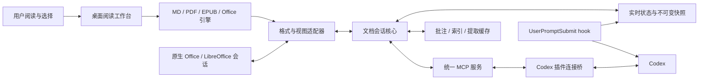

**AgentViewer：综合阅读器、统一阅读状态与 Codex 插件设计调研**

调研日期：2026-10-09。目标平台先按 Windows 桌面横版考虑。

结论：可以构建一个由多种文档引擎组成的综合阅读器，并通过统一 MCP 和 Codex 插件接入。主要工程工作是建立可靠的文档会话、捕捉真实可见区域、固定用户发问时的指代，以及让修改作用于同一个打开的文档模型。

本文区分三类内容：已有项目源码或官方文档已经确认的行为；根据这些行为作出的设计判断；建议实现的协议与验收目标。以下接口名称、JSON 和目录是方案草案，当前项目尚未实现这些功能。本轮核对了公开文档和源码，没有安装各阅读器进行运行验证。

**已有 MCP 的设计可以分成几种。**

| 实现 | 具体实现机制 | 适合复用的设计 | 对综合阅读器还缺什么 |
| --- | --- | --- | --- |
| LibraLM Reader | 阅读 UI 在翻页时调用 app-only 的 sync_reading_context；模型调用 get_reading_context。EPUB 使用 rendition 的 relocated 事件；PDF 上报当前页文本。 | 前端主动采集，模型按需取正文；后台同步操作不必占模型工具列表。 | PDF 的 visibleText 实际是整页文本前 5000 字符；位置主要是描述字符串。需要精确可见区域、统一选区、视图隔离和事件序号。 |
| Obsidian MCP Connector | 插件在 Obsidian 进程内使用 app.workspace 和 app.vault；共享 broker 路由到不同 vault。get_workspace_state 返回标签页、文件、模式和活动状态。 | 使用打开的应用模型；多库路由；工具分组与加载；修改前检查原内容。 | 已核对的工作区接口不返回视口或选区；还需要编辑器与预览 DOM 的位置适配。 |
| Zotero Agent / zotero-mcp | 文献库 MCP 提供检索、全文与注释；Zotero 内的 Agent 面板可在交互时附带当前页和用户选择。 | 让人类阅读界面在发问时提供上下文；引用能回到原文页。 | 内置 Agent 的上下文接入不能直接等同于外部 Codex 聊天的实时状态；需要独立共享会话桥接。 |
| Nelson MCP | LibreOffice 扩展内调用 UNO 文档模型；ToolContext 绑定一次调用的文档；通用 doc 模块加 Writer、Calc、Draw/Impress 模块。工具可用 _document 显式定位打开文档。 | 通用操作加格式操作；稳定 doc_id；用书签、标题等定位修改对象。 | doc_info 和 nav_surroundings 属于文档信息与结构查询，不能当作屏幕可见区域接口；需补视图状态采集。 |
| Word live COM MCP | 每次调用初始化 COM，连接 Word.Application，读取 ActiveDocument、Selection 并执行修改。 | 可以操作用户已经打开的原生文档，包含实时选择与未保存内容。 | current_page 来自 Selection.Information(3)，属于光标/选区所在页。用户仅滚动时，不能据此判断可见页。还需固定目标文档与视图。 |
| SuperDoc MCP | stdio 服务把 DOCX 打开为内存会话，通过 open、inspect、perform_action、save、close 操作；无须挂载浏览器编辑器。浏览器 Editor 另有 selection.current。 | 同一文档引擎的 UI 和无界面接口；可寻址的文本目标；明确的会话与保存步骤。 | 无界面会话不会自动知道另一个 Editor 的滚动和选择。必须让 UI 与 MCP 共用文档会话，或同步可验证的版本。 |
| BrowserClaw Codex 插件 | 插件 launcher 发现正在运行的浏览器端口，再把 Codex stdio 转发至浏览器的 HTTP MCP。 | 阅读器本体独立运行，插件只负责发现、连接与工作流说明。 | 浏览器读页与导航接口仍需文档层的选区、视口和稳定锚点。 |
| BeePub 等书库型 MCP | 以图书、章节、标注、已保存阅读进度为主要对象。 | 图书管理、全文索引、历史进度和跨书检索。 | 保存进度与屏幕当前可见范围是两种数据，需要单独采集。 |

源码依据：[LibraLM 服务端](https://github.com/libralm-ai/libralm-reader/blob/main/src/index.ts)、[阅读 UI](https://github.com/libralm-ai/libralm-reader/blob/main/src/ui/reader.tsx)、[上下文存储](https://github.com/libralm-ai/libralm-reader/blob/main/src/server/tools/book-management.ts)；[Obsidian 工作区状态实现](https://github.com/istefox/obsidian-mcp-connector/blob/main/packages/obsidian-plugin/src/features/mcp-tools/tools/getWorkspaceState.ts)及[broker 设计](https://github.com/istefox/obsidian-mcp-connector/blob/main/docs/architecture/ADR-0027-shared-broker-for-all-clients.md)；[Zotero Agent 设计](https://github.com/54yyyu/zotero-mcp/blob/main/docs/chat-plugin.md)；[Nelson 框架](https://github.com/quazardous/nelson-mcp/blob/main/plugin/framework/tool_context.py)及[使用协议](https://github.com/quazardous/nelson-mcp/blob/main/QUICKSTART.md)；[Word 服务源码](https://github.com/kennypeh85/word-mcp/blob/main/server.py)；[SuperDoc MCP](https://docs.superdoc.dev/agents/mcp/connect/)与[浏览器选区 API](https://docs.superdoc.dev/document-api/reference/selection/current/)；[BrowserClaw 插件](https://github.com/browseros-ai/browserclaw-codex-app)；[BeePub](https://github.com/oalieno/beepub)。

对 LibraLM 要准确描述一个细节：其服务端上下文已经包含 lastUpdated。问题是该时间戳不能提供每个阅读视图的独立身份、客户端事件顺序及状态有效性；currentReadingContext 是进程内单个变量，同一进程里的多个 UI 可能覆盖彼此，风险取决于部署方式。

SuperDoc 的选区接口还说明，选择对象不仅是字符串：可以包含正文、页眉页脚、脚注、文本框等 story，文本块和偏移，或者表格单元格目标。综合阅读器需要保留这种结构。

**从用户的阅读动作，可以推导出本体必须提供的能力。**

| 用户表达或动作 | 阅读器必须知道什么 | 对应能力 |
| --- | --- | --- |
| “解释这一段” | 发问瞬间的选区；没选区时的可见段落；所属文档和章节 | 发问快照、精确选区、可见内容、前后文扩展 |
| “这张图说明什么” | 图像对象或页内区域，标题与邻近正文 | 页面裁剪、对象读取、空间锚点、文本和图像组合 |
| “往前找定义” | 当前章节、当前位置、搜索结果所在位置 | 大纲、全文搜索、邻近内容读取、定位回原文 |
| “改一下这里” | 所指段落或对象、当前编辑版本、是否有未保存修改 | 稳定目标、语义修改、版本检查、预览与撤销 |
| 用户滚动、缩放或改变字号 | 可见区域随布局变化；文字位置不应仅用百分比 | 视图事件、布局坐标转换、内容锚点 |
| 用户切到 Codex 发问 | 阅读器失去操作系统焦点，但最后一次人类阅读位置仍是有效线索 | 记录最后的人类活动视图、显式绑定聊天与阅读会话 |
| 同一文件开了两个窗口 | 相同文档内容、不同阅读位置 | documentId 与 viewId 分离 |
| 看 Excel 或 PPT | 单元格、公式、工作表；幻灯片、形状和备注 | 格式专属结构，不能只抽成纯文本 |

应用只能报告选择、视口和最近活动等可观察信息，无法据此确认用户眼睛正在看哪个字。选择通常提供更明确的指代；屏幕中心或最后点击位置应作为推测并标记来源。

“支持一种文件格式”应拆成能渲染、能抽取结构、能读取当前位置、能修改、能保存并保持格式五项能力。打开成功不能证明后面四项都成立。

**建议统一的是文档会话和位置协议。**

统一概念：

- documentId：打开内容的逻辑身份，保存或另存为时仍可维持会话身份。
- contentRevision：内容模型版本，含尚未保存的编辑；磁盘文件版本单独记录。
- sessionId：阅读会话及其权限与工作区绑定。
- viewId：标签页、窗格或窗口。一个 documentId 可以对应多个 viewId。
- viewRevision / seq：布局和位置状态的序号，不与内容版本混用。
- snapshotId：发问或操作时冻结的不可变快照。
- Locator：指向文档内容的可序列化锚点；可以同时携带原生位置与文本引用。
- Capability：各引擎支持的阅读、选择、修改、保存和保真范围。

[Readium Locator](https://readium.org/architecture/models/locators/)已提供资源、位置和文本上下文的共同结构；[W3C Web Annotation](https://www.w3.org/TR/annotation-model/#text-quote-selector)提供 exact、prefix、suffix 等文字定位方式。可以在这些基础上定义应用的会话协议，增加页内坐标、单元格和幻灯片对象扩展。下述 JSON 是 AgentViewer 的建议结构，并非现有 MCP 标准。

```json
{
  "snapshotId": "snap-184",
  "sessionId": "session-7",
  "documentId": "doc-42",
  "viewId": "view-2",
  "contentRevision": "rev-18",
  "viewRevision": 184,
  "capturedAt": "2026-10-09T09:30:00+08:00",
  "activity": {
    "source": "last-human-active-view",
    "readerHasFocus": false
  },
  "document": {
    "uri": "agentviewer://documents/doc-42",
    "format": "pdf",
    "title": "示例论文",
    "dirty": false
  },
  "visibleRegions": [
    {
      "locator": {
        "kind": "pdf-region",
        "pageIndex": 11,
        "pageLabel": "12",
        "rect": [0.05, 0.24, 0.90, 0.50],
        "coordinateSpace": "unrotated-crop-box-normalized"
      },
      "textRef": "reader://snapshots/snap-184/visible/0",
      "geometryQuality": "exact",
      "textQuality": "embedded-text"
    }
  ],
  "selection": {
    "locator": {
      "kind": "pdf-text",
      "pageIndex": 11,
      "quads": []
    },
    "quote": {
      "exact": "用户选择的文字",
      "prefix": "前文",
      "suffix": "后文"
    },
    "capturedFrom": "human-selection"
  },
  "capabilities": {
    "readText": true,
    "captureRegion": true,
    "annotate": true,
    "editContent": false
  }
}
```

示例中的空 quads 仅用于简化展示；实际 PDF 文字选择必须提供定位区域，或返回明确的定位缺失状态。pageIndex 从 0 开始，pageLabel 用于呈现原文页码。rect 使用 x、y、width、height；实际实现需要在模式中固定坐标原点和旋转处理方式，不能由模型猜测。

位置应按格式保存：

| 格式 | 首选原生定位 | 辅助信息 | 布局变化时如何处理 |
| --- | --- | --- | --- |
| Markdown | 源码范围、块身份、编辑器位置 | 标题路径、文本引用、源文与预览映射 | 根据编辑操作映射位置；失效时用引用重定位 |
| PDF | 页身份、页内矩形或文字四边形 | 字符范围、页标签、提取质量 | 将屏幕坐标变换回统一页面坐标 |
| EPUB | spine/href、CFI 或 DOM Range | 文本引用、章节进度 | 字号变化后恢复内容锚点并重新计算可见范围 |
| DOCX | 文本块、story、表格及原生范围 | 文本引用、段落样式、内容版本 | 由编辑器模型维护位置；页码仅作展示 |
| XLSX | workbook、sheetId、单元格或范围 | 公式、显示值、冻结窗格 | 每个窗格分别记录可见区域；结构编辑后映射范围 |
| PPTX | slideId、shapeId、对象内文字范围 | 形状区域、备注、层级 | 对象移动与文字修改分别处理 |
| 网页 | 页面/导航身份、DOM Range、对象身份 | TextQuote、结构路径、frameId | 页面重载和 DOM 变化后验证锚点 |

文本引用是辅助定位方式。文档有多处相同文本或内容版本不匹配时，应返回歧义或定位失效，不能随意命中第一处。需要源文件、内存内容版本和保存版本之间可审计的映射。

**实时同步分为三个独立步骤。**

1. UI 把滚动、翻页、选择、焦点、字号、缩放和布局变化写入本地会话状态。
2. 用户发问时取得该会话的一个原子快照，固定本次问题的指代。
3. 模型通过 MCP 读取该快照附近的内容，必要时导航或修改，再读取操作结果。

滚动事件可以合并，选择和切换文档应及时提交。在发问边界要等待一次 UI 状态确认，或明确返回最后一次已确认状态与其时间。仅增加后台推送频率不能消除读取和发问之间的竞争。

记录最后的人类活动视图尤其重要：切到 Codex 输入问题时，阅读器自然会失去系统焦点。不能把“失去焦点”解释为“没有阅读上下文”。但程序导航与人类导航应标记不同来源，避免模型自己跳页后覆盖本轮问题的原始指代。

要给会话设置存活信息与关闭状态。没有滚动并不意味着状态过期；“最近内容更新时间”和“应用仍存活、位置仍被确认”需要分开。

MCP 的结构化工具输出、资源引用和变化通知可以承载这些数据。订阅和通知要适配实际协议版本与客户端支持；接收到通知也不能等同于模型自动处理一个新聊天回合。设计中保留按需读取快照的路径。[MCP TypeScript SDK](https://ts.sdk.modelcontextprotocol.io/server)

**共通 MCP 可以保留小而稳定的阅读工具集合。**

以下 12 个工具是方案草案，输入和输出均应有版本化 schema；工具名称尚未注册到 Codex。

| 工具 | 核心输入 | 核心结果及约束 |
| --- | --- | --- |
| reader_list_sessions | 工作区/会话过滤条件 | 打开的文档与视图、最近人类活动、能力声明 |
| reader_open | URI、打开模式、目标会话 | documentId、sessionId、viewId；区分文件不存在与空白新文档 |
| reader_get_context | sessionId/viewId 或 snapshotId、预算 | 原子快照；支持继续读取发问时的冻结快照 |
| document_outline | documentId、contentRevision | 标题、章节、页、表或幻灯片结构及 Locator |
| document_read | documentId、Locator、范围、预算 | 文本、表格、公式、对象和继续读取标记；带内容版本 |
| document_search | documentId、查询、限定范围 | 搜索结果带 Locator、引用和内容版本 |
| reader_reveal | viewId、Locator、呈现方式 | UI 完成定位后的确认及新视图快照 |
| reader_capture | snapshotId 或明确视图、区域 | 页面/对象裁剪图、区域坐标和版本 |
| annotation_apply | 文档、目标、增删改操作、预期版本 | 书签、批注、高亮；区分侧边数据与源文件内注释 |
| document_plan_patch | 文档、语义操作、预期版本 | 解析目标、预览 diff、patchId；此步骤不改变内容 |
| document_apply_patch | patchId、预期版本、幂等键 | 实际修改、版本、修改回执、撤销标识 |
| document_undo | 文档、transactionId、预期版本 | 有条件撤销；不能覆盖其后的用户修改 |

格式专属能力按需提供，例如 sheet_read_range、sheet_set_formula、slide_update_shape、document_save/export。不能把单元格公式修改伪装成任意字符串替换，也不能通过一个无类型 execute 接口绕过目标解析和参数验证。

通用读操作可以用 Locator 判别联合类型。写操作采用类型明确的语义操作，由能力声明告诉模型哪些操作可用；不同引擎的原子性、撤销和格式保真范围也要明确返回。

默认读流程是获取上下文、理解大纲、按需扩展正文。默认写流程是读取并解析目标、准备修改、检查版本后执行、验证回执和 UI。prepare 与 apply 是工程上的两阶段处理，不代表每次修改都必须额外向用户请求批准。

资源可以包含 reader://sessions/<id>/context、reader://snapshots/<id>/visible/<n> 和文档结构片段。模型直接可见的结果应提供简短摘要、定位信息及截断标记；大块内容和图片按需读取。在客户端不能读取资源链接时，工具需要提供兼容的有限内容返回路径。

**主要优化空间集中在语义、状态一致性和数据量。**

| 现有常见处理 | 建议优化 | 解决的问题 |
| --- | --- | --- |
| current_page、progress、active_file 各自表示“当前位置” | 分开当前内容位置、可见区域、选区、最后人类活动 | 避免把光标所在页当作屏幕可见页 |
| 每次位置变化同步整页或整章 | 同步锚点和必要增量；缓存按版本提取的内容 | 降低 IPC、解析和上下文开销 |
| 一个全局 currentReadingContext | 按会话、文档和视图存储；使用序号与关闭标记 | 多窗口、多聊天及乱序事件下保持正确 |
| 读取最新状态后把它用于整个任务 | 在发问时冻结 snapshotId；后续刷新另建快照 | 用户与模型导航不会改变原问题的指代 |
| 导航命令成功就认为用户已经看到目标 | 等待布局和定位确认，并返回新可见范围 | 暴露跳转失败、锚点失效和异步布局问题 |
| 修改依据段落序号或全文字符串 | 使用原生对象身份、范围映射与预期内容版本 | 避免修改错对象和覆盖未保存内容 |
| 所有内容转换为 Markdown | 保留格式原生结构，按需生成阅读摘要 | 表格公式、图、批注与 PPT 对象不丢失 |
| 把支持的所有编辑工具始终提供给模型 | 通用阅读工具稳定，专属工具根据能力和客户端机制按需加载 | 减少无关工具、误选操作和 schema 负担 |
| 扫描 PDF 返回空文本 | OCR 返回位置、置信信息；同时支持区域图像 | 明确文字提取质量，保留图文证据 |

工具数量和 schema 的上下文成本依赖客户端的延迟加载与缓存实现，不能把某项目统计的工具 token 数推广为所有 Codex 回合的开销。事件去抖时间和内容预算应先作为可调参数，再通过真实阅读任务测量。

**阅读器本体可以由已有引擎组成。**

推荐建设一个桌面工作台、一个文档与会话核心、多个格式适配器。渲染和编辑都由同一个内容模型驱动；搜索索引、提取缓存和批注围绕该模型维护。不要在 UI 和 MCP 中独立打开两份可编辑文档，再仅靠磁盘文件保持一致。



初期可以选 Electron 作为工作台容器，以便集中使用 Web 阅读引擎、Node 服务和本地 IPC。这是工程选型建议，不是已经验证的性能优势。Tauri 也可实现，但需要额外评估 Windows WebView2、跨平台布局及本地桥接差异。当前用户范围以 Windows 桌面为先。

| 文档类型 | 可复用本体 | 应新增的适配器能力 | 初期修改范围 |
| --- | --- | --- | --- |
| MD | Markdown 渲染器与 CodeMirror/Monaco 类编辑器 | 源码/预览映射、真实可见块、选择与版本事件 | 源文段落与格式修改，进入同一编辑历史 |
| PDF | PDF.js | 多页可见区域、text layer/页面坐标、选区、图像裁剪、OCR 接口 | 高亮、批注、书签、侧边笔记 |
| EPUB | foliate-js 或 epub.js | 章节、CFI/Range、重排后的可见范围和选择 | 批注、书签、笔记；正文重写另作能力 |
| DOCX | SuperDoc Editor / Document API，或完整 Office 引擎 | UI 与 MCP 共用会话、原生选区、可见块、修订回执 | 文本、批注、修订和引擎支持的结构编辑 |
| XLSX | Univer 或完整 Office 引擎；原生 Excel 可用 COM 接入 | sheetId、各窗格可见范围、选择、显示值与公式 | 单元格与公式等已支持操作 |
| PPTX | 完整 Office 引擎，或原生 PowerPoint / LibreOffice 桥接 | slideId、shapeId、可见画布、选择、备注 | 文本、备注、形状等引擎实际支持的操作 |
| 网页/HTML | 本地 HTML 阅读模式、浏览器扩展或独立浏览器会话 | 活动标签、导航身份、frame、DOM 选择、文本/图片锚点 | 阅读批注；网页操作走浏览器专属能力 |

[PDF.js](https://mozilla.github.io/pdf.js/examples/)已有页面渲染和 viewport 变换基础。[foliate-js](https://github.com/johnfactotum/foliate-js)的 relocate 事件可提供 Range 与章节位置，也提供跳转能力；它的 PDF 适配仍注明 experimental，PDF 可以直接使用独立 PDF.js 适配器。[SuperDoc](https://docs.superdoc.dev/agents/overview/)已经把浏览器编辑与无界面文档引擎分开提供，适合研究如何让两种入口共享模型。

Office 要单独选择实施路线：

- 自行组合 DOCX、表格和幻灯片组件：能较快获得统一外观，但每种格式的导入、公式、布局和导出保真都需要分别验证。Univer 的官方 XLSX 导入/导出走其服务器与 Pro 能力，不能假设开源前端即包含完整离线转换链路。[Univer 导入导出](https://docs.univer.ai/en-US/guides/sheets/features/import-export)
- 嵌入完整 Office 套件：ONLYOFFICE Docs 已有文档、表格、演示和 PDF 编辑器，适合统一编辑工作台，但要部署编辑服务，并通过编辑器 API/插件实现状态桥接。已有“编辑器接入 MCP 服务器”属于 MCP 客户端能力，不能直接当作外部 Codex 控制接口。[ONLYOFFICE Docs](https://api.onlyoffice.com/docs/docs-api/get-started/basic-concepts/)、[编辑器 MCP 接入](https://api.onlyoffice.com/docs/desktop-editors/usage-api/connecting-mcp-servers/)
- 接入原生 Office/LibreOffice：适合先获得既有原文编辑能力，但属于跨应用会话整合；这一步本身不会让所有文档都显示在同一个阅读窗口里。

Excel 已有 Window/Pane.VisibleRange，可读取可见单元格；Word 的 RangeFromPoint 可把屏幕点映射为原文 Range 或 Shape。这些说明原生视图适配具有可实现的基础，但 Word 完整可见文本仍需要窗格、布局和命中测试的组合，不能仅用 Selection 页码。[Excel 可见范围](https://learn.microsoft.com/en-us/office/vba/api/excel.pane.visiblerange)、[Word 屏幕命中测试](https://learn.microsoft.com/mt-mt/office/vba/api/word.window.rangefrompoint)

已有 Koodo/Readest 可以作为完整阅读体验的参考或 fork 基础。若核心目标是让 Codex 获得可信的实时位置，更值得首先固定自己的会话协议；阅读器的书库、同步和界面可以逐步完善。具体复用库与发行方式的许可要求应在确定选型时逐项核对。

PDF 的任意正文改写和 Office 全功能保真编辑是独立的大工程。综合工作台可以先完成可靠阅读、定位和批注，再明确增加各类编辑能力。

**Codex 插件可以承载连接与工作流，还能选择加入发问 hook。**

[官方插件文档](https://developers.openai.com/plugins/build/plugins)确认插件可以组合 skills、MCP 配置和特定安装条件下的生命周期 hooks。当前新包推荐根目录 plugin.json/mcp.json 的 portable 格式；.codex-plugin/plugin.json 和 .mcp.json 的 Codex 兼容布局仍被支持。

初期个人项目可参照已经存在的 BrowserClaw 桥接插件，使用如下兼容布局。该目录仅是设计草案，当前没有创建其中的程序文件。

```text
plugins/agent-viewer/
  .codex-plugin/plugin.json
  .mcp.json
  skills/reading/SKILL.md
  skills/editing/SKILL.md
  hooks/hooks.json
  hooks/reading-context.mjs
  server/launch.mjs
  assets/
```

阅读器应用自身应另行分发或明确安装。插件 launcher 负责发现运行中的应用、检查协议版本、建立本地连接；不要在每个聊天中重新启动一个互不共享状态的阅读器。第一阶段可使用 stdio MCP 桥接，应用内部走受限本地 IPC；也可让 MCP 服务直接提供 HTTP。运行端点、认证和版本通过每用户运行信息发现，避免把固定端口当作应用身份。

Skill 负责让模型知道何时读取阅读上下文、如何扩大前后文、怎样引用原文和执行局部修改。它提供工作流指导，不能保证每轮都已注入当前状态。

对于支持并信任 hook 的本地安装，建议 UserPromptSubmit 做一次短操作：确认聊天绑定的阅读会话，冻结 snapshotId，返回小段位置与选区摘要。正文仍交给 MCP 按需读取。

```json
{
  "hookSpecificOutput": {
    "hookEventName": "UserPromptSubmit",
    "additionalContext": "AgentViewer 阅读快照数据：snapshotId=snap-184；sessionId=session-7；documentId=doc-42；viewId=view-2；文档为示例论文，原文页码12。已固定本轮用户选择。需要正文时调用 reader_get_context，指定 snapshotId=snap-184。"
  }
}
```

官方 [UserPromptSubmit](https://learn.chatgpt.com/docs/hooks#userpromptsubmit)支持上述 additionalContext 形状。这里的文档标识、工具名及摘要内容是方案示例。可以同时保留无 hook 路径：由模型调用 reader_get_context 获取当前状态。

绑定与预算有几个要求：仅在绑定到阅读会话的聊天中注入；限制摘要长度和超时；把文档摘录标记为数据；不把整个文档每轮加入上下文。若 UI 未响应，应明确报告可用的最后确认快照，不能伪称实时。

插件 hook 的支持存在发布边界：官方文档说明手动安装到 Codex desktop 的插件可包含生命周期 hooks，含 hooks 的包不符合公共插件目录条件；安装插件也不会自动信任其 hook，需要用户查看并信任当前定义。基础 MCP + Skill 包和本地 hook 增强包可以分别发行。这是后续产品安装要求，本轮没有安装或请求执行 hook。

[MCP Apps 的 UI 文档](https://developers.openai.com/plugins/build/chatgpt-ui)描述了 ChatGPT 内的 iframe 与兼容宿主桥接。可将轻量阅读视图作为可选 MCP App，但不能据此假设 Codex 插件能替换任意原生预览器或挂载完整长期桌面编辑器。主阅读器保持独立，能减少宿主 UI 能力差异带来的耦合。

**实现顺序与验收应围绕真实阅读任务。**

第一阶段：MD、PDF、EPUB 的阅读、选择、位置同步、引用跳转和批注；统一会话与发问快照；Codex 本地 MCP + reading skill，支持的本地安装增加 hook。Markdown 的局部编辑可纳入同阶段，因为能够控制编辑模型和保存链路。

第二阶段：DOCX 与网页阅读。把 SuperDoc 的可寻址文本目标接入同一会话核心；网页选择与活动标签通过扩展或浏览器会话桥接。验证同一模型下的 UI 修改与 MCP 修改，以及未保存文档的可读性。

第三阶段：根据实用样本确定 Office 方案，再增加 XLSX/PPTX 的结构读取、视口、选择和编辑能力。对各引擎单独声明保真范围与不可用功能。

需要验证的关键场景：

1. PDF 只滚动不点击，返回的可见区域仍随视图变化；缩放、旋转、跨两页与扫描页分别验证。
2. EPUB 改变字号、窗口宽度和分页模式后，原选区与书签可恢复到内容。
3. 同一文件两个视图、多个文档和多个 Codex 聊天同时打开，状态不会串用。
4. 用户切到 Codex 发问后，“这一段”仍绑定到此前的人类选区；模型或用户后来跳页不会改写该快照。
5. 用户在模型读取之后编辑目标，后续写入能够识别版本冲突；一次操作重复提交不重复修改。
6. MCP 修改后 UI 显示同一版本，保存后的文件再打开仍能对应修改回执；撤销不会丢掉之后的人类编辑。
7. 阅读器关闭、重启、端口变化、事件乱序或布局尚未完成时，返回明确的状态，能够重新发现会话。

性能指标先记录滚动结束到状态确认、发问 hook 的附加延迟、工具输出大小和单次区域提取成本；再依据样本设定目标。本文没有运行数据，不给出已达到的延迟或准确率。

交付边界：本文完成现有设计比较、能力推导、统一协议和插件接入方案。阅读器应用、MCP 服务和插件的运行能力仍需要后续实现与验证。
