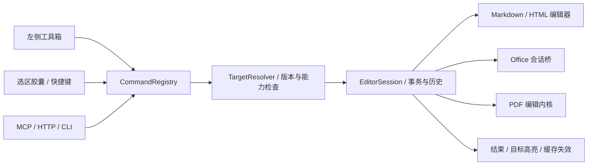

# AgentViewer 按文档类型重构左侧工具箱：需求分析与 MCP 契约

日期：2026-10-12。状态：需求设计；本文件不代表所列功能已经实现。

本轮从编辑任务、对象模型和引擎能力重新规划左侧工具箱，不沿用当前“目录／查找／工具”的界面分类。面向横版桌面，验收视口为 1280×800、1440×900、1920×1080，并覆盖 Windows 100%／150%／200% 缩放。已有引擎与接口可以复用，现有布局不构成设计约束。

本文件是新左栏的产品和接口基线；[全面编辑能力规划](EDITING_CAPABILITIES_PLAN_2026-10-12.md)继续负责编辑引擎、保真和完整能力路线。本文件第 3–8 节替代该旧规划中与左栏组织冲突的部分，不改变翻译独立文件、标签多开、无常驻底栏等规则。

详细附件：

- [Word／PPT／Excel 工具箱要求](LEFT_TOOLBOX_OFFICE_REQUIREMENTS_2026-10-12.md)。
- [Markdown／本地 HTML 工具箱要求](LEFT_TOOLBOX_MARKDOWN_REQUIREMENTS_2026-10-12.md)。
- [PDF 工具箱要求](LEFT_TOOLBOX_PDF_REQUIREMENTS_2026-10-12.md)。

## 1. 要解决的问题与使用任务

工具多并不等于编辑能力完整。完整闭环包含：找到对象 → 理解当前属性 → 选择作用范围 → 修改 → 看到实际结果 → 撤销／保存 → 重开验证。缺少任一环节的按钮不能作为已完成工具计数。

左栏应当同时提供三种能力：文档结构导航、按任务组织的编辑工具箱、所选对象的精确属性。它们可以共享一个面板，但不应混成无层级的长按钮列表。PPT 的页面缩略图、Excel 的工作表和名称范围、Word 的标题和样式具有不同的数据与交互模型，不能统一为同一份文字目录。

| 使用任务 | 用户必须能完成 | Agent 必须能完成 |
| --- | --- | --- |
| 阅读并定位 | 在标题、页面、工作表、书签、搜索结果间跳转，保持阅读位置 | 取得稳定身份、当前可见范围和来源，不靠猜测文字匹配 |
| 修改文字／样式 | 选区格式、段落样式、清除格式，知道继承或混合状态 | 读取真实属性，指定目标、参数和版本，局部应用后核对 |
| 重组内容 | 章节、幻灯片、PDF 页面、表格行列的增删、复制与移动 | 使用对象 ID 和明确目标位置，预览受影响引用和对象 |
| 插入对象 | 表格、图片、公式、链接、文本框、图形等，编辑其属性 | 导入受控资源并调用同一对象命令，取得新增对象 ID |
| 处理数据 | Excel 范围编辑、公式、排序、筛选、验证与图表 | 读取公式／类型／结果分别表示的数据，批量事务，验证关系 |
| 审阅与输出 | 批注、修订、差异、导出、保存冲突恢复 | 区分应用批注与原生批注、未保存版本与磁盘版本，取得产物回执 |

### 1.1 产品完成条件

1. 不同格式有独立的工具目录、默认面板和对象属性，公共基础组件复用。
2. 每个编辑命令都具有语义接口，UI、快捷键、上下文菜单、MCP 调用同一实现。Agent 无需先点击侧栏按钮才能执行编辑。
3. 左栏完整工具箱与单行选区胶囊共享命令。工具箱提供完整参数，胶囊提供当前选区最常用的快捷入口；不另建两套高亮、格式或替换逻辑。
4. 有引擎能力但缺少 UI 的命令须补 UI；只有按钮而没有真正写入／撤销／保存的命令不开放。
5. 未支持命令可在“完整能力目录”中显示依赖和实现状态，默认常用面板不堆积大量无效按钮。
6. 各类文档编辑不影响文档独立翻译规则；选区译文和全文译文不作为原文编辑命令。

## 2. 参考依据与设计推导

以下引用用于核实已有产品／协议的机制；之后的尺寸、分组与命令是 AgentViewer 的需求设计，并非宣称产品提供相同 API。

| 依据 | 观察到的机制 | 在本项目中的应用 |
| --- | --- | --- |
| [PowerPoint 左侧缩略图](https://support.microsoft.com/en-us/powerpoint/show-or-hide-slide-thumbnails) | 编辑视图左侧提供幻灯片缩略图，可调整面板 | PPT 以真实缩略图为默认结构入口，文字大纲作为替代视图 |
| [PowerPoint 对象选择窗格](https://support.microsoft.com/en-gb/powerpoint/use-the-selection-pane-to-manage-objects-in-documents) | 对象列表可帮助选择、显示／隐藏和调整层次 | PPT 页面与页面内对象分层导航，避免仅用正文文字代替对象 |
| [LibreOffice Navigator](https://help.libreoffice.org/latest/en-US/text/shared/01/navigator.html) | 按文档结构定位不同对象 | Word 不只显示标题，还须索引表格、图片、书签、字段等 |
| [Typora Markdown Reference](https://support.typora.io/Markdown-Reference/) | Markdown 编辑覆盖结构语法与扩展内容 | Markdown 工具箱按照语义块设计，源码与可视编辑共享映射 |
| [CodeMirror 6 文档](https://codemirror.net/docs/) | 文档、选择及扩展围绕编辑状态和事务组织 | 源码编辑产生可映射的事务，不通过全文件字符串重写承担所有命令 |
| [MCP Tools 2025-11-25](https://modelcontextprotocol.io/specification/2025-11-25/server/tools) | 工具有参数 schema，可提供结构化返回、输出 schema 与列表变更通知 | 使用少量稳定工具族和可查询命令目录；活动文档的可用性通过目标能力查询获得 |
| [Chromium 完整可访问性树](https://developer.chrome.com/blog/full-accessibility-tree) | 跨进程 frame 的可访问性树需要分别取得 | 网页／HTML 的语义目标携带 frame 身份，不能把顶层 DOM 当完整页面 |

需求不采用“把 Office Ribbon 旋转成竖向列表”的做法。Ribbon 按编辑任务分组的思想值得保留，但左栏需要更强的上下文属性和结构定位，减少左右来回切换。PPT／PDF 的缩略图与复杂属性可以在同一左栏内切换或上下分区。

## 3. 新左侧工具箱的整体结构

### 3.1 三层结构

```text
固定标签栏
┌──────┬───────────────────────────┬───────────────────────────────┐
│格式  │ 当前格式工具箱             │ 正文／画布                     │
│任务栏│ ┌───────────────────────┐ │                               │
│      │ │ 当前分组标题与工具搜索  │ │   自动隐藏的统一导航胶囊       │
│页面  │ ├───────────────────────┤ │                               │
│文字  │ │ 导航列表／缩略图／属性  │ │                               │
│插入  │ │ 组内常用工具            │ │                               │
│布局  │ │ 可折叠高级参数          │ │                               │
│审阅  │ ├───────────────────────┤ │                               │
│      │ │ 当前目标与一次操作结果  │ │                               │
└──────┴───────────────────────────┴───────────────────────────────┘
```

任务栏是格式专用的分类入口，宽 48px，按钮可点击区域不小于 36×36px。默认显示 5–7 个一级分类；更多低频能力纳入末项“更多”，但完整命令目录可搜索。分类使用不同语义图标并提供统一悬停提示，不以相同图标或文字首字母区分。

工具箱默认 320px、可拖动至 260–480px；PPT 缩略图默认 264px，PDF 默认 248px。面板距窗口内容边缘 12px，圆角 22px，采用轻量磨砂玻璃，不生成 SVG 折射纹理。完整正文折射用于导航、Agent 底部操作胶囊，以及覆盖正文的 AI 结果／选区译文小浮窗；AI 大抽屉仍为磨砂。工具箱动画只作用于位移、透明度和尺寸过渡；正文渲染／缩略图缓存不随动画逐帧重建。

阅读模式可仅保留结构面板，编辑模式默认打开格式常用工具组。面板展开挤出正文布局，不覆盖文档；正文可用宽度低于 720px 时，优先收起未固定的 AI 抽屉，复杂表格允许横向滚动。顶栏、内容区、侧栏各自受固定布局容器约束，面板开合不能使应用整体滚动或隐藏标签栏。

### 3.2 顶栏、左栏、选区胶囊与右栏的职责

| 区域 | 职责 | 主入口规则 |
| --- | --- | --- |
| 统一导航胶囊 | 导航／地址、模式、正文缩放、文档撤销／重做、保存 | 不承载完整字体／段落／数据工具箱；文档不显示文件路径 |
| 左工具箱 | 格式工具完整目录、结构导航、对象属性、多步骤编辑 | 所有格式编辑参数的主要入口；每个命令只在一个组内归属 |
| 选区／对象胶囊 | 选区相关的高频操作及打开对应属性组 | 单行图标；更多项跳转左栏同一命令，不再次展开完整参数面板 |
| 右 AI 工具栏 | 问答、改写、提取、独立译文、任务入口 | AI 内容范围明确；不放另一套常驻字体或页面工具 |
| 命令面板／上下文菜单 | 键盘发现、低频操作、目标相关菜单 | 共用 CommandRegistry；属于访问方式，不是另一套逻辑 |
| 设置窗口 | 默认行为、工具显示／顺序、阅读偏好、引擎状态 | 一次性“旋转当前页”“排序区域”等操作不变成设置开关 |

### 3.3 面板交互与上下文

- 再次点击已打开分类即收起工具箱，只保留任务栏；点击另一分类切换内容。无需单独常驻收起按钮。
- 每个 view 保存分类、滚动位置、分区高度、宽度、折叠状态；不同标签、同文档不同视图互不覆盖。全应用默认布局可按格式设置。
- 用户显式切到“布局／插入”等组时，选择对象不强制切组。该组内显示适用属性与目标摘要；“跟随选择”只影响属性子区，可关闭。
- 对象工具默认针对最后一个稳定的人类选择。点击按钮或输入参数保留选择快照；输入法组合期间不替换目标。Agent 的选择独立记录，不能把人类工具箱自动跳到其目标。
- 目标摘要说明“第 3 页／两个图片”“正文第 2 节”“数据表!B2:D18”等，不显示技术 ID；详情可展开用于诊断。无目标时展示“插入到当前位置”或提示先选目标，不能默认改整份文档。
- 多选显示共同值、混合值或不适用；混合态不伪装成默认值。样式继承值、直接格式和用户待提交值分别表示。
- 输入框 Enter 提交、Escape 取消待提交参数。颜色／尺寸拖动可在引擎支持时实时预览，整次拖动为一个事务；失焦取消策略必须一致。并发编辑同目标时中止预览，不回写旧快照。
- 连续画笔／高亮／格式刷提供明确退出状态，Escape 退出；临时工具关闭后回到选择工具。
- 详情和高级项按组折叠，常用参数优先；图标命令提供名称、快捷键、作用范围与禁用原因提示。表单保留可读标签，不能把全部参数改成无解释图标。

## 4. Markdown 工具箱

默认阅读组“结构”，编辑组“写作”。章节是层级结构，格式工具围绕块／内联范围，不依赖模糊的全文匹配。详细映射见 Markdown 附件。

| 分类 | 展示内容与具体功能 | 目标／结果 | 命令族（规划） |
| --- | --- | --- | --- |
| 结构 | 标题树、折叠、当前标题、章节移动／升降级、块列表、书签 | sectionId／blockId；移动章节携带完整后代及引用更新 | `markdown.section.*`、`markdown.block.*` |
| 写作 | 正文／标题／引用、粗斜体／删除线／行内代码、清除格式、有序／无序／任务列表、缩进 | 真实 range 与块；判断语法嵌套、混合态、转义 | `markdown.mark.*`、`markdown.list.*` |
| 插入 | 表格、图片、链接、脚注、分割线、代码块、公式、Mermaid、引用块 | 创建对象并返回稳定身份；资源进入文档资源管理 | `markdown.insert.*`、`markdown.asset.*` |
| 表格与块属性 | 行列增删、对齐、单元格编辑、转置；代码语言、公式源码、图表源码 | 当前表格／代码／公式块；维持有效语法 | `markdown.table.*`、`markdown.code.*`、`markdown.math.*` |
| 资源与引用 | 图片列表、缺失路径、链接检查／重定位、脚注、引用定义、front matter | 原资源／引用的明确 ID，不以同名文件猜测 | `markdown.link.*`、`markdown.frontMatter.*` |
| 查找与审阅 | 选区／章节／全文查找替换、正则、大小写、评论／摘录、字数统计 | 替换预览带范围与数量；应用批注独立保存 | `document.search/replace`、`annotation.*` |
| 输出 | 格式化当前块／全文、导出 HTML／PDF、资源打包 | 显式列出源码格式变化；阅读主题不写回源文件 | `markdown.format`、`document.export` |

可视、源码、分栏都操作同一个原文模型与共同历史。默认保存保留未改片段的换行、BOM、编码及未知扩展；未知语法和 raw HTML 使用源码编辑岛。格式化全文是一条明确命令，不能在打开或切模式时偷偷重排全部源码。多行、跨块及重复文字必须使用范围映射，而非 `indexOf` 定位。

## 5. Word／Writer 工具箱

默认阅读组“导航”，编辑组“文字与段落”。工具应有真正分页和对象模型支持，连续文字预览只能作为受限模式。

| 分类 | 必须包含的工具 | 需要的目标和模型 |
| --- | --- | --- |
| 导航 | 标题树、真实页面缩略图、书签、表格／图片／字段列表、查找跳转 | textRange、headingId、sectionId、page anchor；页码为布局产物 |
| 文字与段落 | 字体／字号、字符效果、颜色、高亮、清除直接格式、段落对齐、行段距、缩进、制表位、项目符号／多级编号、边框／底纹、格式刷 | 字符属性与段落属性分开；混合 run、样式继承、编号对象 |
| 样式 | 段落／字符／列表样式库、预览、应用、修改、创建、继承检查、查找同样式 | 稳定 styleId；修改样式需预览影响的所有对象 |
| 插入 | 表格、图片、形状、文本框、超链接、书签、公式、分页／分节、脚注／尾注、字段 | 新对象 ID；锚定和文字环绕，不以空格／换行模拟排版 |
| 布局 | 纸张、方向、边距、分栏、页眉页脚、页码、节、图片裁剪／环绕、对象层级、表格行列／边框 | pageStyle／section／frame；只改明确选节或页面样式 |
| 引用与审阅 | 目录、图表目录、题注、交叉引用、原生批注／回复、修订开关、接受／拒绝、比较 | 引用和修订的稳定 ID；原生批注与应用摘录分组 |
| 输出 | 保存 DOCX、另存、固定版本 PDF／打印、兼容性报告 | 未保存模型导出，不先覆盖磁盘；字段／布局检查结果 |

关键场景：选中表格时“文字与段落”仍可用，但出现表格子区；选图片显示尺寸、裁剪、环绕、锚定；选择多段时不只更改第一个段落。章节移动不能拆丢书签、脚注或浮动对象。纯页码定位不作为 Agent 长期编辑引用。

## 6. PPT／Impress 工具箱

PPT 默认打开“幻灯片”。左栏顶部可切“缩略图／大纲”；缩略图是引擎真实渲染，展示页序、隐藏状态、备注／批注标记、错误标记，不用文本卡片代替。默认单列，调宽后可选两列；按文档修订、页修订、主题和输出尺寸缓存。

| 分类 | 必须包含的工具 | 交互要求 |
| --- | --- | --- |
| 幻灯片 | 真实缩略图、章节、增删复制、拖动排序、多选、隐藏／取消、版式、背景、尺寸 | 拖动显示插入线；Esc 取消；一次移动一个事务；粘贴可选择使用源主题或目标主题 |
| 文字 | 字体／效果／颜色、段落／项目符号、文字框边距、垂直对齐、溢出策略 | 文本范围与文本框对象分开；溢出明确提示，不无限缩小字体 |
| 插入 | 文本框、图形／连接线、图片、表格、图表、公式、音视频、链接 | 真实对象、资源及关系；新对象默认落入可见画布，返回 objectId |
| 对象与排列 | 对象树、显示／隐藏／锁定、分组／拆组、层级、对齐／分布、位置／尺寸／旋转、吸附、裁剪 | 画布选中与列表双向对应；对象层级和无障碍阅读顺序分别处理 |
| 设计 | 主题、配色／字体、母版、版式、背景、占位符 | 普通页与母版模式明确区分；主题修改预览影响范围 |
| 动画与放映 | 对象动画、触发／时长／顺序、页面切换、排练／放映、备注 | 时间线只在相关组展开；编辑不误触播放；harness 有显式预览命令 |
| 审阅与输出 | 批注、讲稿备注、页面比较、检查字体／资源／溢出、PPTX／PDF／图片导出 | 对象属性与备注草稿一起在保存前提交；输出按冻结版本 |

“幻灯片＋对象属性”工作方式：页面组内可固定缩略图区域，下方为当前页／对象的简洁属性；选择复杂对象时点击“完整属性”进入对象组，并保留上方最小页面导航。默认不在正文再放第二条常驻 Ribbon。多选页面与多选对象是不同的 selectionKind，不能混用删除命令。

## 7. Excel／Calc 工具箱

默认阅读组“工作簿”，编辑组“单元格”。公式栏／名称框属于工作表画布的编辑设施，由引擎提供，不复制到左栏形成两个不同步的输入框。左栏提供公式构建器、属性和数据操作。

| 分类 | 必须包含的工具 | 关键语义 |
| --- | --- | --- |
| 工作簿 | 工作表列表、增删复制移动／重命名、隐藏、颜色、名称范围、表格／图表索引、跳转 | sheetId 独立于名称；隐藏不等于删除；多 sheet 选择有明确范围 |
| 单元格 | 字体／色彩／边框、数字格式、对齐／缩进／换行、合并拆分、保护、清除值／格式／全部 | 文本、数值、日期、布尔、公式、错误和格式分开；多范围混合态 |
| 插入与布局 | 行列／单元格移动、宽高、自动适应、冻结、隐藏、图片／图表、打印区域、分页、纸张 | 结构改变更新公式、名称、表格及图表引用；有不能迁移的关系则拒绝 |
| 公式 | 函数搜索与参数向导、公式编辑、填充、引用锁定、名称管理、依赖追踪、重算、错误定位 | 读取 formula／cachedValue／calculationStatus；不把缓存旧值当计算成功 |
| 数据 | 排序、筛选、表格、去重、分列、查找替换、验证／下拉、条件格式、导入、透视表 | 默认范围明确；是否有标题、是否含隐藏行、是否扩展选择必须显示 |
| 图表与分析 | 图表类型／源数据／轴／标签、透视字段、汇总函数、刷新、统计 | 引擎真对象；源范围和图表对象关联；刷新任务有进度与失败原因 |
| 审阅与输出 | 注释／批注、保护、差异、兼容性、XLSX／CSV／PDF 导出 | CSV 导出仅选工作表并声明类型／公式／格式损失，不能宣称工作簿保真 |

排序默认将同一记录的完整选定行一起排序，不能只移动某列造成数据错位。合并非空单元格需损失预览。带公式区域的结构命令必须由公式引擎调整引用和重算；仅修改公式字符串、仅保存 ZIP 或调用 ExcelJS 不作为完整 Calc 能力验收。跨工作簿引用、宏和外部数据源分别列入受限能力，不随打开文档执行。

## 8. PDF 工具箱

默认阅读组“页面”，编辑组依任务为“内容”或“注释”。必须区分现有内容编辑、新增覆盖、原生批注、应用侧摘录、真实脱敏和数字签名；它们的保存和可撤销范围不同。

| 分类 | 必须包含的工具 | 目标与结果 |
| --- | --- | --- |
| 页面 | 真缩略图、多选、增删／复制／移动／旋转、裁剪、插入／提取／拆分／合并、页标签 | 稳定 pageId；所有页序变更更新书签、链接、批注及回跳映射 |
| 目录与查找 | 书签树、创建／重排／编辑、页跳转、文字／注释搜索、区域读取 | 引擎文本顺序与视觉顺序区分；扫描页说明没有文字层 |
| 内容 | 原文文字块编辑、字体／字号／行距、图片增替／裁剪／变换、图形、链接、水印／页眉页脚 | 内容对象 ID、字体可用性、重新排版与覆盖范围报告；新增覆盖不可称为原文修改 |
| 注释 | 高亮／下划线／删除线、便笺、文字框、图形、自由绘制、印章、颜色／透明度／作者、回复／状态、清单 | 标准可编辑 PDF 注释对象；选区高频标记在胶囊，左栏提供完整样式和列表 |
| 表单 | 填写与创建文本／勾选／单选／下拉／签名字段、必填／验证、tab 顺序、导入／导出数据 | AcroForm 字段 ID、值和 appearance；XFA 独立能力状态 |
| OCR与处理 | OCR 页／范围／语言、文本层生成、扫描纠偏、压缩、附件与元数据、无障碍标签检查 | 后台任务冻结版本；OCR 回写和只读取结果是不同命令 |
| 脱敏与签名 | 标记待脱敏区域、检索标记、应用并验证、签名／验证状态 | 删除实际内容并检查残留；签名图像不等于密码学签名；破坏既有签名须明确报告 |
| 输出 | PDF 保存／另存、带批注副本、扁平化、页面图片、提取文字／资源、打印 | 扁平化影响后续编辑能力；输出以冻结版本及覆盖报告为准 |

PDF 坐标以 PDF 用户空间点和页变换矩阵为权威；UI 使用 CSS 坐标时同时提供 pageId、CropBox、rotation、userUnit、zoom／DPR 与 layoutRevision。不能把归一化显示矩形直接用于所有旋转／裁剪页面。对象定位失效就重新解析，不通过相同文字的首个匹配继续修改。

## 9. 网页与本地 HTML

远程网页默认不展示左工具栏，沿用此前“网页左栏精简”的要求。页面目录、阅读副本、查找可从导航模块／命令面板进入临时工具箱；它们使用相同宿主，但不为了统一架构增加常驻工具。网页原地翻译和鼠标／键盘操作继续提供。不得把修改当前 DOM 显示宣称为已保存到网站。

本地 HTML／阅读副本是可编辑文档，具有独立左工具箱：结构树、文字样式、块／表格／图片插入、链接与资源、CSS 属性、源码、审阅／导出。源码与结构修改共用 HTML AST、稳定节点引用和局部补丁；未知标签／属性保留，净化预览与原文件内容分离。资源清单显示外部链接、相对路径、缺失状态与离线收集结果。

远程网页编辑分为 `browser.input`（真正的交互）、`web.displayPatch`（临时显示修改）、`browser.readingCopy`（独立副本）三种明确动作。浏览器表单提交是网页动作，不能通过文档保存接口触发。跨 frame 的语义读写携带 frameId 和导航身份；页面脚本更新后旧 DOM 引用、旧翻译恢复记录与旧坐标失效。

## 10. 统一命令与模块架构

### 10.1 分层



`FormatToolboxContribution` 负责分类、工具分组、面板和默认布局；`CommandRegistry` 负责名称、schema、状态、执行及事务。分组、排序、图标修改不改变命令 ID。React 组件不直接改 ZIP、字符串或引擎模型；MCP 不执行任意 JavaScript、UNO dispatch URL 或宏。

| 模块（规划） | 职责 |
| --- | --- |
| `ToolboxHost / ToolboxLayoutStore` | 固定布局边界、开合、宽度、视图级恢复、键盘切组 |
| `FormatToolboxContribution` | 每种格式贡献 categories／panels／command references／default layout |
| `ToolboxContextService` | 人类选择、稳定目标、能力、当前属性、草稿与锁定状态 |
| `CommandRegistry / CommandStateProvider` | 参数和结果 schema、单一执行入口、enabled／mixed／reason、命令版本 |
| `TargetResolver / AnchorResolver` | 结构身份、映射、空间坐标、引用更新、明确失败 |
| `EditorSession / EngineAdapter` | 同一未保存模型、原生读写、共同历史、快照及保真保存 |
| `TransactionService / UndoProvider` | 幂等、准备／提交、失败回滚、目标级逆操作和冲突 |
| `ThumbnailService / ObjectPreviewService` | 真实渲染、修订键缓存、异步缩略图、取消和资源预算 |
| `CommandEventBridge` | 用户／Agent 来源、真实操作高亮、简短结果、harness 订阅 |

### 10.2 命令定义

```ts
interface EditorCommandDefinition {
  id: string; schemaVersion: string; format: string[];
  categoryId: string; groupId: string; label: string; icon: string;
  targetKinds: string[]; inputSchema: JSONSchema; outputSchema: JSONSchema;
  effect: 'view' | 'document' | 'artifact' | 'website';
  undo: 'native' | 'conditional' | 'none';
  availability(context: EditorContext): CommandState;
  prepare(request: CommandRequest): Promise<CommandPlan>;
  execute(plan: CommandPlan, context: ExecutionContext): Promise<CommandReceipt>;
}
interface CommandState {
  enabled: boolean; reasonCode?: string; reason?: string;
  value?: unknown; mixed?: boolean; inherited?: boolean;
  coverage: 'complete' | 'partial' | 'unavailable';
}
```

上述是需求契约示意，不是现有类型。实际 schema 必须共享生成、验证 unknown fields／数值范围／枚举／资源大小，不能只用 TypeScript 接口实现运行时校验。

## 11. MCP 与 Harness 详细要求

### 11.1 现有与新增的边界

已存在：`workspace_list`、阅读上下文／选区／快照、`document_read/capabilities/outline/search`、`document_plan_patch/apply_patch/undo/save`、`reader_selection_tools/action`、浏览器输入／导航／截图、`reader_set_zoom`。Office 的新增基础操作已进入 `editOperationSchema`。

现有能力尚不足以支撑完整工具箱：缺少完整语义对象分页查询、属性／混合状态查询、范围／多对象选择、标准命令目录、统一 redo 和可靠条件逆操作。当前 `document_undo` 是保守事务撤销，不等于完整共同历史。以下 API 是拟新增或扩展，不能标为已经可调用。

### 11.2 工具族

| MCP 工具（规划） | 输入与用途 | 返回必须包含 |
| --- | --- | --- |
| `document_list_commands` | documentId／viewId、类别、分页，读取当前对象可用命令 | schemaVersion、commandId、enabled／reason、覆盖限制、cursor |
| `document_get_command` | commandId 与目标身份 | 具体 input／output schema、单位、目标类型、撤销能力 |
| `document_list_objects` | 结构根、类型、page／sheet／slide、范围、分页 | stable ref、简洁摘要、parent／children 状态、revision、完整性 |
| `document_get_properties` | targetRefs、propertyNames | 值／混合／继承／不可用状态；真实引擎数据 |
| `reader_resolve_target` | 稳定 ref 或来源 anchor，指定视图 | 解析后的 ref、版本、位置、变换、是否降级 |
| `reader_select_targets` | viewId、targetRefs、是否 reveal | 语义选择快照及来源；不自动激活 Agent 未授权切换的其他标签 |
| `document_prepare_command` | 明确文档／视图／commandId、参数、版本、幂等前置信息 | planId、目标清单、diff／损失／布局风险、preconditions、expiresAt |
| `document_commit_command` | planId、idempotencyKey | receipt、实际修改范围、对象映射、警告、版本、undo token |
| `document_history` | documentId、分页、可撤销查询 | 历史摘要、目标／来源、允许撤销／重做及冲突原因 |
| `document_undo_command / redo_command` | 事务或条件 undoToken、预期状态 | 是否已撤销／重做、实际影响与新修订；不得重复执行同一事务 |
| `document_export` | 冻结版本、格式、明确输出路径／应用目录、范围与选项 | artifactId、path、hash、sourceRevision、coverage、损失报告 |
| `document_job_start/status/cancel/resume` | OCR／大范围处理等 taskId 和版本 | 实际阶段／单位／结果；异步任务不返回虚假同步成功 |

MCP 的 `tools/list` 保留稳定工具族，不随用户当前选区不断增删几十个工具。命令状态通过目标查询更新。可增加 `markdown_edit / word_edit / slides_edit / sheets_edit / pdf_edit / html_edit` 的严格 discriminated operation schema，供熟悉格式的 Agent 直接 prepare；所有工具族最终进入同一命令注册表。禁止只给一个无约束 `execute({code})` 代替工具能力。

### 11.3 请求和回执

```json
{
  "documentId": "doc-id",
  "viewId": "bound-view-id",
  "commandId": "slides.objects.align",
  "schemaVersion": "1.0",
  "expectedRevision": 18,
  "target": {"kind": "objects", "refs": ["slide:s3/object:o8", "slide:s3/object:o12"]},
  "parameters": {"axis": "horizontal", "alignment": "center", "reference": "slide"}
}
```

示例为规划格式，不能直接提交现有 MCP。上述命令指定“对象在幻灯片上水平居中”，与多个对象之间相互居中是不同 reference，schema 必须表达。

回执至少包括 `transactionId、documentId、viewId、commandId、beforeRevision、afterRevision、affectedTargets、createdTargets、removedTargets、targetMappings、warnings、coverage、undo、idempotencyKey`。导出再包含 artifact 元数据；网页动作再包含 navigation／layout／viewport。错误是结构化 `code/message/details/retryable/currentRevision`，MCP `isError=true`；不只把错误转成 `String(error)`。

### 11.4 稳定目标和并发

- 所有编辑显式绑定文档和视图。用户换标签不能让 Agent 下一步漂移到新标签。
- 文字用稳定 block／range 与 revision；Office 用引擎对象引用；PPT 用 slideId＋objectId；Excel 用 sheetId＋范围及结构映射；PDF 用 pageId＋object／annotation／field refs。
- 名称、页号、行号、显示标题是查询条件或展示值，不能作为唯一长期身份。Sheet 改名、插入行列、PDF 调序后更新目标映射。
- prepare 与 commit 都校验目标和版本。目标无变化时可使用经过证明的局部重基；目前未实现可靠映射时拒绝，不整份覆盖。
- 继续保留未提交人类草稿保护、IME 保护和按文档提交队列。Agent 不通过自动 blur 或强制保存来夺取人类编辑权。
- 相同幂等键＋相同请求返回旧回执；相同键＋不同请求拒绝。连接重试不重复插入段落、页面或提交网页。
- 单次拖动／范围粘贴／页面重排是一个事务。原生引擎 undo 分组不自动等同于原子事务；失败要验证回滚，报告部分修改。
- 目标级撤销仅在逆操作可靠且目标前置条件成立时开放；已被他人更新的同一目标返回冲突，其他目标的新内容保留。

### 11.5 读回与事件

每个新增编辑功能的验收必须包含 MCP 读属性／对象 → prepare → commit → 读回 → undo → save → 新会话重开，不能只测试按钮 click 成功。Agent 操作事件携带实际 targets、actor、commandId、transactionId 和真实阶段；正文高亮目标，底部提示简短显示“改字号”“移动 3 页”等，不仅笼统显示“编辑文档”。

长读返回分页、总量／未知总量、truncated 与 omittedReasons；大型公式区域、PDF 对象或文档模型不能默认塞入完整 MCP response。截图与缩略图采用资源或图像返回，并提供版本、CSS／位图尺寸和坐标变换。订阅或 SSE 是性能扩展，MCP 仅支持请求时仍可查询有效事件游标；不把应用自定义事件伪装成协议标准通知。

## 12. 引擎与实现策略

| 格式 | 目标实现方向 | 工程门槛 |
| --- | --- | --- |
| Markdown | CodeMirror 6 原文模型＋AST／稳定 block 映射；可视编辑器适配层 | 原文保真、跨模式选择／历史、未知语法、局部序列化与 IME 验证 |
| Word／PPT／Excel | 内置完整 Office 会话；优先验证 LibreOffice UNO host，保留可替换 adapter | Windows 内嵌／受管会话、多个 view、真实视口／选择、同一模型和保存、DPI／焦点；不是直接调起外部窗口就完成 |
| PDF | PDF.js 读取与显示＋真正 PDF 编辑内核，候选 MuPDF | 原文对象编辑、标准批注、字体／变换、表单、脱敏、签名与许可证方案分别验收 |
| 本地 HTML | AST＋CodeMirror＋受控结构编辑器与资源管理 | 源码保留、安全预览、节点映射、离线资源关系 |
| 网页 | Chromium 原生视图＋CDP／可访问性／DOM 适配器 | frame／导航／布局版本、真实输入、明确临时修改与远程提交边界 |

现有 OOXML／ExcelJS 增量继续作为过渡能力，不能与完整 Office 引擎同时写同一会话。完整引擎接入后，共同历史、读取及保存均由同一 EditorSession 提供。选定 MuPDF 等依赖前按项目发布方式核实许可证；本轮不会因需求设计而擅自安装新引擎或宣称完成内嵌。

## 13. 性能、可访问性与恢复

- 侧栏展开仅订阅当前分类需要的数据；关闭后取消预览／缩略图任务。命令状态按目标／revision 增量更新，不轮询全量模型重绘属性树。
- PPT／PDF 缩略图和 Office 对象树虚拟化，优先当前可见项和前后缓冲；缓存以文档／对象修订键和容量约束管理。未完成缩略图显示占位，不能以老图冒充当前版本。
- 导航、Agent 底部胶囊，以及 AI 结果／选区译文小浮窗生成完整光学纹理。所有非正文覆盖的工具箱、设置控件、搜索框和 AI 大抽屉保留 CSS 磨砂；关玻璃／高对比／减少透明度不生成光学资产。
- 面板开合保留可中断短过渡，减少动效尊重用户偏好。数据载入、字体切换、公式重算的任务耗时与装饰动画区分，操作完成以实际回执为准。
- 任务栏使用 button／tab 的准确语义；组内键盘可达，焦点顺序连续；颜色不能作为唯一状态。混合态、禁用原因、真实任务进度可读屏。
- 窗口关闭先提交或保存草稿恢复点，失败保留窗口。面板状态、对象选择和阅读锚点按 view 恢复；缺失对象明确降级，不能定位错误页仍显示“已恢复”。
- 批量删除、真脱敏、合并丢失、扁平化等有明确结果预览；普通可撤销格式编辑不额外套一轮确认弹窗。所有需要确认的弹窗使用统一样式和可读目标清单。

## 14. 实施拆分与交付顺序

| 阶段 | 交付内容 | 出阶段门槛 |
| --- | --- | --- |
| T0 | 统一命令目录、能力／属性状态、目标类型、schema、UI／MCP 同路测试 | 同一个格式命令从 UI 和 MCP 得到等价结果；未知／受限目标正确拒绝 |
| T1 | 新 ToolboxHost、任务分类、宽度／状态恢复、轻量磨砂、搜索和无障碍 | 三桌面尺寸和三 DPI；开合不隐藏标签栏、不撑高根容器；重复点击收起 |
| T2 | Markdown 结构／写作／表格／资源完整基础闭环 | 源码保真、跨块与重复文字、IME、模式切换、保存重开 |
| T3 | Office 会话桥验证；先 Word／PPT／Excel 三种真实渲染／选择／编辑 | 每种完成原生对象读写、未保存快照、共同历史、内置运行及 harness 验证 |
| T4 | Word 样式／布局／插入，PPT 真缩略图／对象／设计，Excel 公式／数据／图表工具 | 分格式样本和 MCP 流程，不以三种相同基础按钮替代 |
| T5 | PDF 页面／标准注释／内容／表单／OCR；脱敏和签名单独里程碑 | 每能力对象持久化、旋转 CropBox、非零原点、外部阅读器重开验证 |
| T6 | 本地 HTML、网页临时工具、差异／导出、长期恢复与性能 | 来源／资源完整、网页不误保存远端、后台任务和缓存清理不损产物 |

基础优先不删除高级需求。每项命令单独记录 `planned / engineReady / implemented / verified / restricted`，进入“verified”至少满足第 11.5 节闭环与格式专用验收。T3 内嵌不可行时按既有引擎规划提供受管窗口过渡，并显式报告未满足内嵌工具箱门槛。

## 15. 必须通过的验收场景

| ID | 场景 | 通过标准 |
| --- | --- | --- |
| TB-01 | 多标签、两个视图打开同文档、分别切工具组 | 工具箱状态独立；文档修改共享；Agent 固定目标 |
| TB-02 | 展开／收起、拖动宽度、切分组和小窗口 | 顶部标签不消失；无常驻底栏；正文和原生网页边界匹配 |
| TB-03 | 选区后点颜色／字体／尺寸输入、IME 进行中 | 保留目标；不因面板抢焦点而改错对象；IME 完成前不提交 |
| TB-04 | 多选不同属性、取消预览、拖动连续参数 | mixed 正确；取消不覆盖他人修改；一次拖动一个 undo |
| TB-05 | 所有可见编辑命令逐项走 UI 与 MCP | 参数、结果、限制、撤销和保存一致；无 UI-only 能力 |
| TB-06 | Agent 准备后用户修改同目标，再提交 | 拒绝或经严格映射安全重基；不覆盖人类新内容 |
| TB-07 | 重复请求、重新连接、重放回执 | 无重复页面、对象或数据写入；不同 payload 同键拒绝 |
| TB-08 | Markdown 重复段落、未知语法、换行/BOM、跨块格式 | 编辑准确；未改字节保留；切模式不 dirty |
| TB-09 | Word 混合样式、表格、节、环绕图片、修订 | 原生属性正确，关联内容保留；兼容报告明确 |
| TB-10 | PPT 100 页／多选拖动／母版对象／图片与备注 | 真缩略图、排序与对象对应；母版限制正确；溢出可见 |
| TB-11 | Excel 中文表名、公式、合并、排序、隐藏行、图表 | 类型／关系保持，公式有效重算；预览的范围与执行一致 |
| TB-12 | PDF 旋转、裁剪、扫描页、表单、脱敏和已签名样本 | 实际内容与注释持久化；脱敏无可提取残留；签名状态准确 |
| TB-13 | 网页 SPA／跨 frame／导航后旧目标、本地 HTML 资源 | 旧引用拒绝；缺失范围报告；临时 DOM 修改不称为远端保存 |
| TB-14 | 未保存草稿、关闭／崩溃、后台导出中继续编辑 | 恢复正确版本；导出固定发起版本；不丢输入 |
| TB-15 | 关闭侧栏／玻璃后统计、长文档与百页缩略图 | 无非必要折射资产；不可见列表不全量渲染；无性能重复工作 |
| TB-16 | 键盘／读屏／减少动效／高对比 | 分类和参数可达，焦点可见，混合／限制状态可读 |

验收报告必须记录样本格式、引擎版本、UI 与 MCP 实际命令、磁盘产物和重开结果。截图证明界面，结构／字节／外部引擎验证证明内容；两者都需要。

## 16. 本轮交付与后续边界

本轮交付需求文档、格式附件、命令和验收设计；新左栏界面尚未实现。当前已有编辑能力以最新代码的 `document_capabilities` 和现有 operation schema 为准。未来实施应先建立 T0 命令／状态契约，再替换工具箱宿主，避免先做完整按钮目录、后补无效业务实现。
