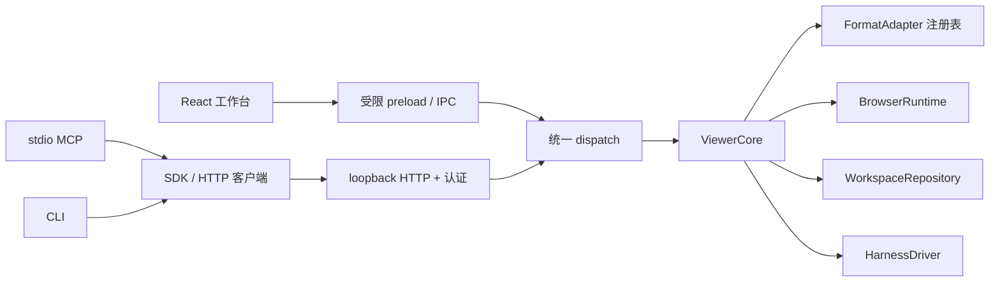

# 接口与扩展

日期：2026-10-09。以下区分当前可调用接口与预留契约；预留项没有默认实现，不应在 UI 或 MCP 中宣称可用。

## 当前调用链

工作区和格式状态属于 `ViewerCore`。UI 编辑、harness 编辑和保存共用这个模型；harness 不能通过直接替换磁盘文件伪造打开的内容已经更新。

## 身份、版本和读取

| 字段 | 当前语义 |
| --- | --- |
| `documentId` | 一份打开的内容模型；同一路径多视图共享此身份 |
| `viewId` | 独立阅读位置、选区、模式和窗口；操作尽量显式指定 |
| `revision` / `contentRevision` | 内容修订；修改和撤销递增，保存不增加内容修订 |
| `diskRevision` | 最近成功保存的修订；恢复检查点与源文件保存分别管理 |
| `viewRevision` | 视图采集修订；不等于文档内容发生修改 |
| `snapshotId` | 进程内不可变的内容模型与上下文副本；包含未保存内容 |
| `navigationId` | 网页主 frame 导航身份；旧页面坐标不能沿用 |
| `actor` | human / agent / engine；bearer 客户端不能伪造人类位置 |
| `quality` | confirmed / last-confirmed / not-ready；恢复位置先标为最后确认 |

源码 `from/to` 当前使用 JavaScript UTF-16 偏移，右端不包含。PDF 页码从零开始；PDF 增补坐标为页面左上原点的归一化坐标，当前仅支持未旋转、CropBox 原点为零的页面。网页坐标为视口 CSS 像素，正 `deltaY` 向下滚动。

未指定视图时，默认使用最近明确的人类阅读视图，再使用活动视图。首轮尚无每个 harness 的绑定；多任务应显式携带 `viewId` 或 `snapshotId`。关闭的视图不会被偷偷替换为另一个视图。

当前快照是进程内资源，最多保留约 100 个，正在运行任务引用的快照受保护。重启或淘汰返回 `SNAPSHOT_EXPIRED`。PDF 快照尚未冻结可读取的二进制 artifact，当前固定的是页面模型与已采集文字/选区；不能据此宣称完整旧 PDF 正文可读。

## 修改闭环

1. `read` / `context` / `capabilities` 确认目标、修订与可用操作。
2. `prepare(documentId, expectedRevision, operation)` 返回前后内容和限制，不改变文档。
3. `commit(patchId, idempotencyKey)` 再次检查修订，按文档串行应用，返回事务回执。
4. `save(documentId, path?)` 检查源文件摘要，写临时文件、核验内容并替换目标；只有成功后更新磁盘修订。
5. `undo(transactionId)` 仅在事务之后没有其他编辑时恢复，避免覆盖后续人类内容。

当前每个 patch 只有一个操作。多操作原子事务、完整 diff UI、持久撤销历史和部分失败恢复待补。提交回执与 patch 随工作区检查点保存；相同键不同请求返回 `IDEMPOTENCY_CONFLICT`。网页外部副作用与本地回执持久化之间存在崩溃窗口，首轮不提供跨进程的 exactly-once 保证。

## 当前接口表

| 用途 | dispatch/CLI method | MCP tool |
| --- | --- | --- |
| 工作区 | `state` | `workspace_list` |
| 打开文件/网页 | `open` | `reader_open` |
| 位置、选区 | `context`, `selection` | `reader_get_context`, `reader_get_selection` |
| 固定上下文 | `snapshot`, `snapshot-read` | `reader_create_snapshot`；读取工具可携带 snapshotId |
| 正文、能力、大纲、搜索 | `read`, `capabilities`, `outline`, `search` | `document_read`, `document_capabilities`, `document_outline`, `document_search` |
| 准备、提交、撤销、保存 | `prepare`, `commit`, `undo`, `save` | `document_plan_patch`, `document_apply_patch`, `document_undo`, `document_save` |
| 激活、复制、关闭 | `activate`, `duplicate-view`, `close` | `reader_manage_views` |
| 网页输入/导航/截图/副本 | `browser-input`, `browser-navigate`, `browser-capture`, `browser-copy` | `browser_input`, `browser_navigate`, `browser_capture`, `browser_reading_copy` |
| Harness | `harness-list`, `harness-submit`, `harness-cancel` | 暂无专门 MCP task tools |

HTTP 通用入口为 `POST /api/command`，JSON 为 `{method,args}`；直接入口包括 `/v1/commands/prepare`、`/v1/commands/commit`、`/v1/browser/input` 和 `/v1/views/:viewId/context`。SSE `/api/events?after=seq` 提供进程内有限事件重放，过旧游标返回 `resync_required`。事件并不直接启动模型新回合。

外部请求使用 bearer；工作台使用自己的 cookie / preload 通道。认证失效、错误 Origin、伪造界面上下文、错误修订和错误导航均有显式失败。尚无逐文档客户端绑定和撤销；不能将首轮 token 等同于细粒度授权。

## 浏览器输入与截图

请求必须包含 `viewId`、`expectedNavigationId`、`action` 和唯一 `idempotencyKey`。可选 `expectedViewport` 对 width/height/scrollX/scrollY 做检查，超过 1 CSS 像素差异返回 `STALE_VIEWPORT`。后台网页不接受输入。输入后返回重新采集的真实视口与选区。

截图返回 PNG、位图尺寸、导航身份及 CSS 视口。若截图期间导航或视口改变，则失败重试；不能把一次截图和另一页面的 navigationId 拼接成有效请求。MCP 返回真实 image 内容块和元数据。

当前只有原生坐标输入；DOM 元素引用、可访问性树、跨 frame、下载、剪贴板等能力后续通过 `BrowserSemanticExtension` 增加。没有暴露任意 JavaScript 执行工具。

## 已落地的替换入口

| 契约 | 代码入口 | 替换规则 |
| --- | --- | --- |
| `FormatAdapter` | contracts + `AdapterRegistry.register(adapter, replace)` | 新引擎负责打开、预览、应用和输出 bytes；启动时替换默认适配器，不在未处理的活动事务中热切换 |
| `BrowserRuntime` | contracts + `core.browser` | 当前为 Electron；外部 Chrome/CDP 可提供相同导航、输入、上下文和截图接口 |
| `HarnessDriver` | contracts + `core.drivers` | submit 接收固定快照、流式回调与 AbortSignal；新驱动明确声明是否可附着已有会话 |
| `WorkspaceRepository` | persistence + ViewerCore 构造参数 | 当前为 JSON，后续 SQLite 接口保持 load/save，迁移需保留旧恢复点 |
| HTTP/MCP/CLI | sdk `dispatch` | 同一核心调用，不为每种传输另建状态。未来 MCP resources / 分页仍从同一内容修订读取 |

当前格式枚举、命令联合与前端 `DocumentPane` 仍是内建注册。增加 EPUB 等新格式还需扩展契约、打开路由和 renderer，不能将 `AdapterRegistry` 误称为已支持任意第三方动态插件。

## 预留升级契约

`packages/contracts/src/extensions.ts` 已定义但未默认接入：

- `ExtensionDescriptor`：扩展版本、协议主版本与可用功能/缺失原因。
- `ViewBridge`：真实位置上报、带修订的回跳、区域图像；分离视口与 caret。
- `OfficeGateway` / `OfficeEngineSession`：ONLYOFFICE/Collabora 等 live session、engineEpoch、准备/提交、导出与状态桥。
- `BrowserSemanticExtension`：带导航与 frame 身份的元素引用、预算和未覆盖 frame 列表。
- `AuthorizationProvider`：按客户端/文档/视图/能力判断与撤销。
- `ArtifactRepository`：二进制版本、摘要、引用生命周期；支持 PDF 旧快照和离线资源。

下一阶段按这些契约实现后，再注册对应 UI/MCP 能力。内容版本、身份、选区、固定问题快照和保存回执继续作为公共层；Office 原生操作、PDF 页面对象、EPUB CFI 与站点提交保留各自的格式语义。
